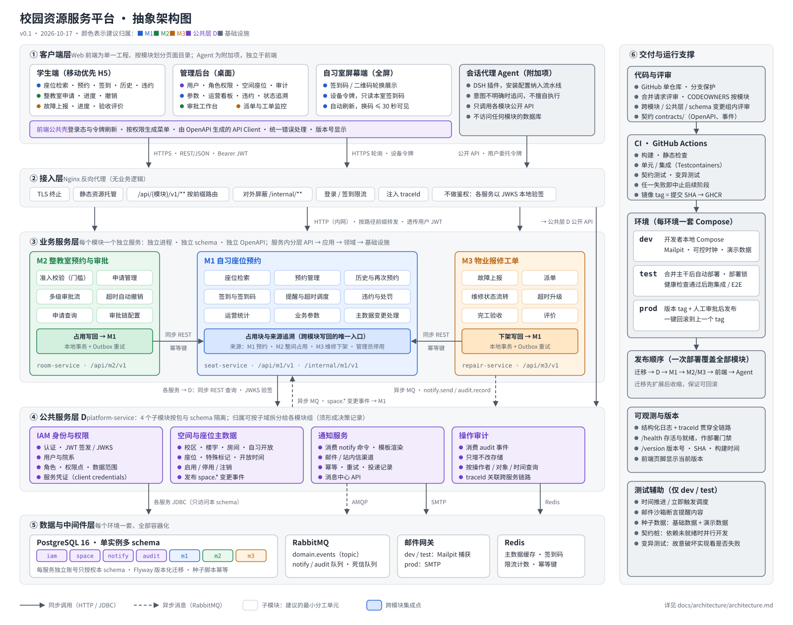
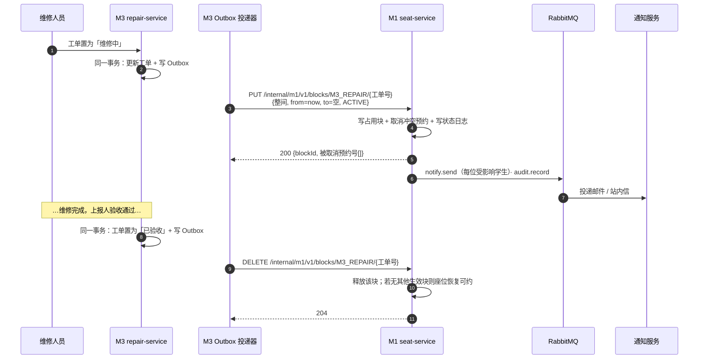
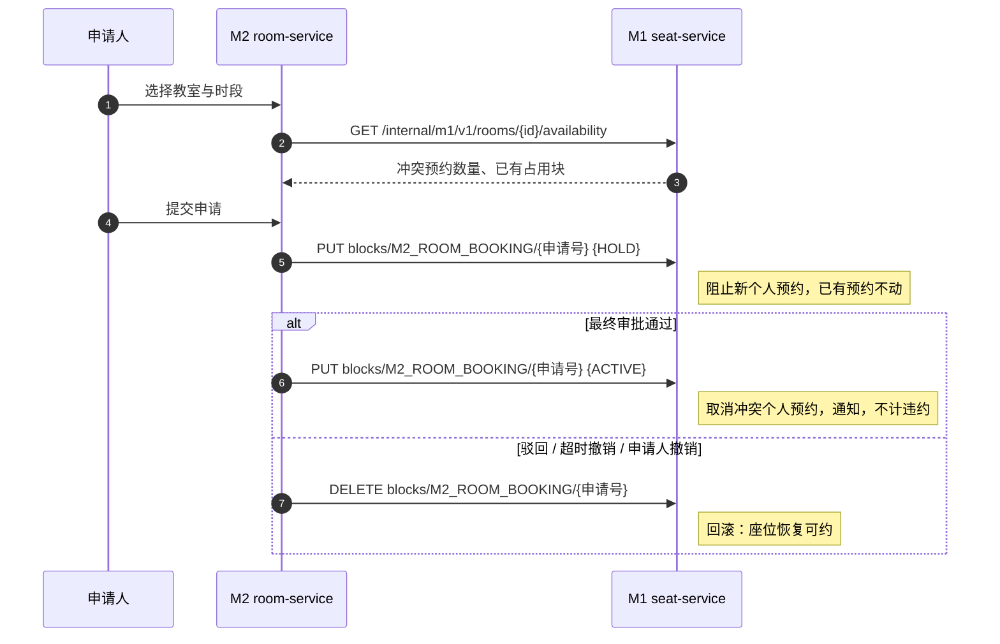
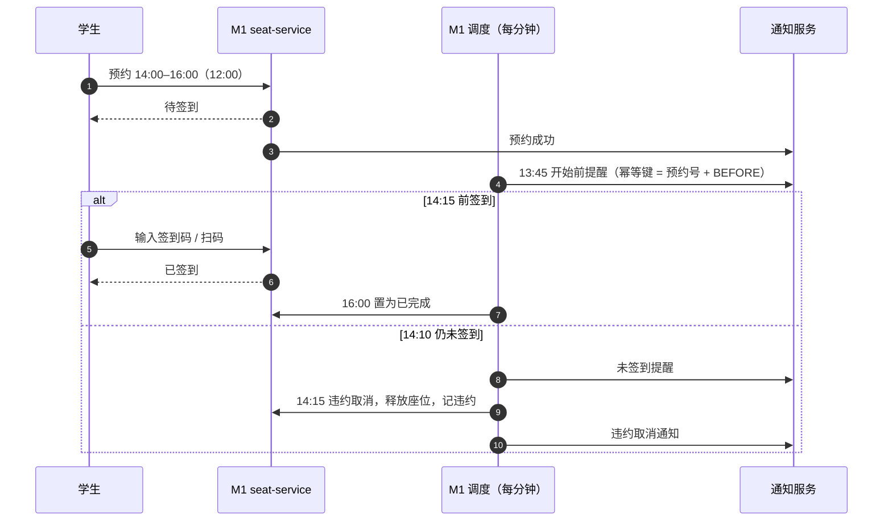
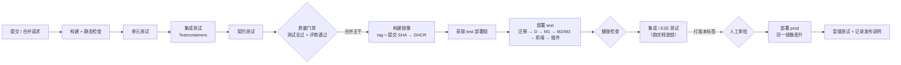
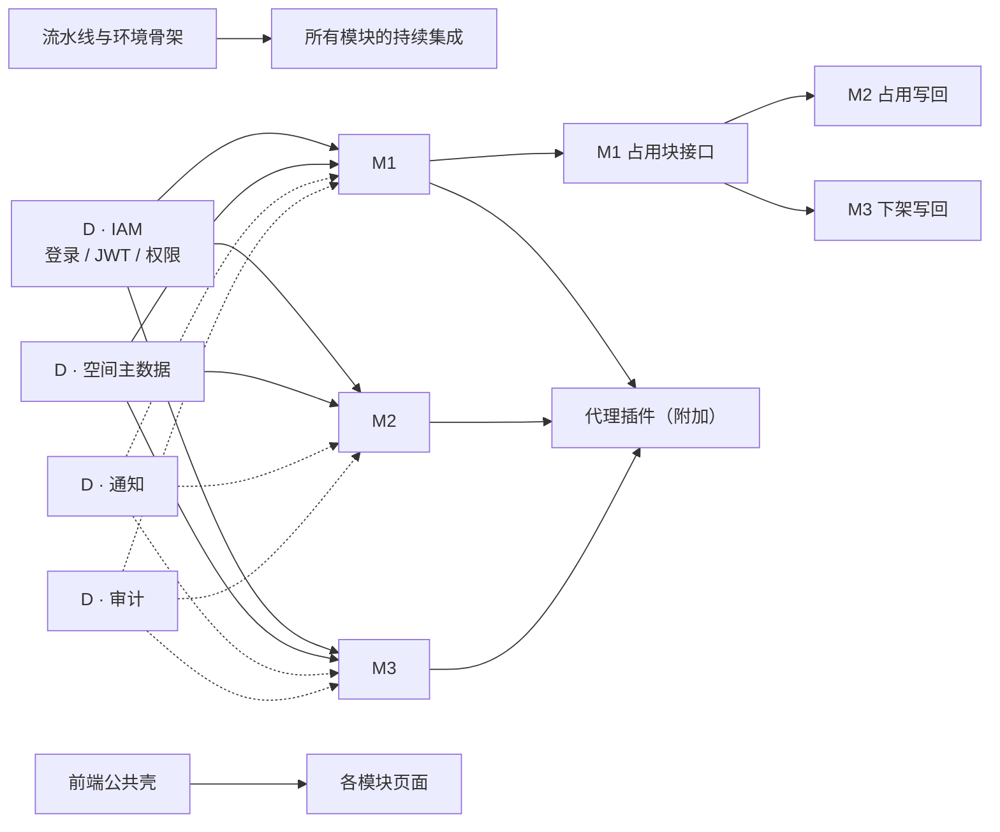

# 系统架构设计（抽象架构）

> 依据：《Pj-任务书》、[需求总览](../requirements/README.md)。本文的取舍汇总在 §12。

---

## 1. 架构驱动因素

先把任务书中**会直接决定架构形状**的约束列出来，后文每个设计选择都能回指到这里。

| 编号 | 约束 | 来源 | 对架构的影响 |
| --- | --- | --- | --- |
| C1 | 期末须演示「模块 A 通过网络调用模块 B，展示状态写回效果」 | 任务书 §七-5 | 模块必须是独立进程，模块间走网络接口 |
| C2 | 代理只能通过各模块公开接口调用，不得访问其他模块的数据库或内部实现 | §五 | 每个模块有公开 API；数据按模块隔离 |
| C3 | 模块组是开发与分工的单位；公共层归属可按子域拆分；须考虑故障责任归属 | §二 | 模块边界 = 服务边界 = 代码目录边界 = 数据边界 |
| C4 | 一次部署覆盖全部模块；组内发布顺序须协调；须约定部署窗口 | §三 | 单仓库、统一流水线、有序发布、部署锁 |
| C5 | 生产需人工审批、可回滚、能说明当前版本 | §三 | 不可变镜像 + 版本标签；`/version` 端点；迁移向后兼容 |
| C6 | schema 以版本化迁移脚本演进，空库可重放；种子数据幂等 | §三 | 每个服务自管迁移，流水线自动执行 |
| C7 | M1 座位状态须记录写入来源（M1 / M2 / M3） | §二 | M1 内设统一的「占用块」模型与状态日志，作为写回唯一入口 |
| C8 | 基础设施脚本化，推荐容器化 | §三 | Docker 镜像 + Compose，每个环境一份配置 |
| C9 | 测试须真的验证行为（故意破坏实现应导致失败） | §三 | 时间可注入、邮件可捕获、可做变异测试 |

---

## 2. 架构风格选型

| 候选 | 描述 | 优点 | 缺点 | 结论 |
| --- | --- | --- | --- | --- |
| A 单体 | 一个后端进程，模块是包 | 最简单，事务一致 | C1 只能「模拟」网络调用；边界全靠自律；一处出错全站下线，故障难归属 | 不选 |
| B 模块化单体 | 一个进程，模块间通过 HTTP 调用自身 | 部署简单 | 本质仍同进程同发布，C3、C4 的分模块发布与故障归属无从体现 | 不选 |
| **C 粗粒度服务化** | 每个业务模块一个服务，公共层一个（或按归属拆成几个）服务 | 边界天然；网络调用真实；可独立测试、故障隔离；与模块组一一对应 | 需要处理分布式一致性；运维组件增多 | **采用** |
| D 细粒度微服务 | 再细拆，加注册中心、配置中心、K8s | 「最企业级」 | 对 6 人课程项目过重，基础设施工作量挤占业务 | 不选 |

**采用方案**：粗粒度服务化 + 单仓库 + 单一前端工程 + 每环境一个数据库实例、按 schema 隔离。

---

## 3. 总体架构图



> 图中颜色表示**建议归属**：蓝 M1 / 绿 M2 / 橙 M3 / 紫 公共层 D / 灰 基础设施。每个圆角小方块（子模块）是建议的最小分工单元。
> 图由 [gen_architecture.py](gen_architecture.py) 生成：在本目录执行 `python3 gen_architecture.py architecture.svg`。改图请改脚本，并同步更新本文。

五层自上而下：

1. **客户端层**：一个 Web 前端工程，内含学生端、管理后台、自习室屏幕端三类入口；会话代理（附加项）独立于前端。
2. **接入层**：Nginx 反向代理，只做路由、TLS、限流、traceId 注入，不含业务逻辑也不做鉴权。
3. **业务服务层**：M1、M2、M3 各一个服务。M2、M3 对 M1 的状态写回统一进入 M1 的「占用块」子模块。
4. **公共服务层 D**：身份与权限、空间与座位主数据、通知、审计四个子模块。
5. **数据与中间件层**：PostgreSQL（多 schema）、RabbitMQ、Redis、邮件网关。

右侧为交付与运行支撑：代码评审、CI、三套环境、发布顺序、可观测性、测试辅助。

---

## 4. 分层与子模块职责

### 4.1 客户端层：Web 前端（单一工程）

| 子模块 | 职责 | 建议归属 |
| --- | --- | --- |
| 前端公共壳 | 登录与令牌刷新；按权限生成菜单与路由守卫；由 OpenAPI 生成的 API Client；统一错误提示；组件规范；页脚版本号 | D |
| 学生端 · 座位 | 搜索、预约、我的预约、签到（输码 / 扫码落地页）、历史与再次预约、违约 | M1 |
| 学生端 · 整教室 | 申请、进度、撤销 | M2 |
| 学生端 · 报修 | 上报、进度、验收评价 | M3 |
| 管理后台 · 平台 | 用户与导入、角色与权限、数据范围、空间与座位、标记、开放时间、通知模板、审计查询 | D |
| 管理后台 · 座位运营 | 业务参数、预约明细、违约管理、运营看板与导出、屏幕终端、状态追溯 | M1 |
| 管理后台 · 审批 | 审批工作台、审批链配置 | M2 |
| 管理后台 · 工单 | 派单、工单监控、升级规则 | M3 |
| 自习室屏幕端 | 全屏展示签到码与二维码，定时刷新；使用设备令牌 | M1 |

**边界规则**：模块页面只通过**本模块**的 API Client 调用**本模块**后端；需要跨模块时用页面跳转（如「一键报修」跳到 M3 页面并带参数），不在前端拼装其他模块的业务逻辑。

### 4.2 接入层：Nginx

| 职责 | 说明 |
| --- | --- |
| 静态资源托管 | 前端构建产物 |
| 路由 | `/api/{iam\|space\|notify\|audit\|m1\|m2\|m3}/v1/**` 按前缀转发到对应服务 |
| 屏蔽内部接口 | 外部请求 `/internal/**` 一律 404 |
| 限流 | 登录、签到接口 |
| 链路标识 | 注入 `X-Request-Id` / `traceparent` |
| 不做的事 | 不做鉴权、不做聚合。各服务作为资源服务器，用 IAM 发布的公钥（JWKS）本地验签 |

> 为什么不用网关统一鉴权：鉴权放在服务内，权限点与数据范围校验才能和业务代码放在一起测试；网关保持「哑管道」，换实现成本低。备选是在 Nginx 用 `auth_request` 统一验签，见 ADR-006。

### 4.3 业务服务层

每个服务内部统一分四层：**API 层**（公开 `/api/{m}/v1`、内部 `/internal/{m}/v1`）→ **应用层**（用例编排、事务、权限校验）→ **领域层**（实体、状态机、业务规则）→ **基础设施层**（仓储、对外客户端、消息发布、定时任务）。领域层不依赖框架，便于单元测试与变异测试。

#### M1 自习座位预约（seat-service）

| 子模块 | 职责 | 拥有的数据 | 对应需求 |
| --- | --- | --- | --- |
| 座位检索 | 按条件计算可约座位；座位时间轴 | 只读：占用块、主数据缓存 | M1-RSV-01、M1-SRH-* |
| 预约管理 | 创建、取消、自动完成；BR-01 ~ BR-11 校验；预约状态机 | 预约、预约状态变更 | M1-RSV-* |
| 历史与再次预约 | 历史查询、再次预约预填、收藏 | 只读：预约 | M1-HIS-* |
| 签到与签到码 | 签到码生成与轮换；屏幕设备令牌；签到校验 | 签到码、屏幕设备 | M1-CHK-* |
| 提醒与超时调度 | 开始前提醒、未签到提醒、超时取消、到期完成、宕机补偿 | 任务锁 | M1-REM-*、M1-RSV-05 |
| 违约与处罚 | 违约记录、暂停计算、撤销 | 违约、预约限制 | M1-VIO-* |
| 运营统计 | 实时看板、指标、低利用率识别、导出 | 只读；可选日聚合表 | M1-OPS-* |
| 业务参数 | `m1.*` 参数的读取、校验与修改 | 参数 | M1-CFG-01 |
| 主数据变更处理 | 订阅 `space.*` 事件，处理受影响预约 | — | M1-INT-05 |
| **占用块与来源追溯** | 占用块写入 / 升级 / 释放（内部 API）；冲突处理；状态日志；追溯查询。**所有使座位不可约的写入都只走这里**，包括 M1 自己的预约 | 占用块、座位状态日志 | M1-INT-01 ~ 04、06 |

M1 内部依赖方向：检索、预约 → 占用块；调度 → 预约、违约；运营统计只读。

#### M2 整教室预约与审批（room-service）

| 子模块 | 职责 | 对应需求 |
| --- | --- | --- |
| 房间检索 | 可申请房间检索、占用日历（调用 M1 可用性查询） | M2-ROOM-* |
| 准入校验（权限门槛） | 申请权限、房间级门槛、时间与容量、数量、信用 | M2-ELG-* |
| 申请管理 | 提交（冲突校验、匹配审批链并固化快照）、撤回、取消、管理员撤销 | M2-APP-* |
| 多级审批流 | 待我审批、逐级通过 / 驳回、防止自审、并发只生效一次、审批时间线 | M2-APV-* |
| 审批链配置 | 预置与维护审批链规则 | M2-FLOW-* |
| 超时自动撤销 | 每分钟扫描审批截止、截止前提醒、到期完成 | M2-TMO-* |
| 申请查询 | 我的申请、申请管理、统计 | M2-QRY-* |
| 占用写回 → M1 | 状态变化与 Outbox 同事务写入，投递器调用 M1 占用块接口并重试；写回状态可见 | M2-INT-01 ~ 03 |
| 外部事件处理 | 订阅 `m3.workorder.*`（维修影响）与 `space.*`（房间不可用） | M2-INT-04、06 |

> 详细需求见 [m2-room-booking.md](../requirements/m2-room-booking.md)。

#### M3 物业报修工单（repair-service）

| 子模块 | 职责 | 对应需求 |
| --- | --- | --- |
| 故障上报 | 选择位置（来自空间主数据）、类别、描述、图片附件（存挂载卷）、重复提示、取消 | M3-RPT-* |
| 派单 | 受理派单、改派、退回、自动派单、关闭无效工单 | M3-DSP-* |
| 维修状态流转 | 工单状态机：待受理 → 已派单 → 维修中 → 待验收 → 已完成；影响范围、进度备注、完工提交 | M3-WRK-* |
| 超时升级 | 分阶段计时，每分钟扫描，L1 通知调度员、L2 通知物业主管 | M3-ESC-* |
| 完工验收 / 评价 | 验收通过 / 不通过、评价、自动验收、代验收 | M3-ACC-* |
| 工单查询与统计 | 我的报修、工单工作台、统计、按位置查历史 | M3-QRY-* |
| 下架写回 → M1 | 进入「维修中」写入占用块，验收通过或维修中关闭时释放；走 Outbox | M3-INT-01 ~ 03 |
| 工单事件发布 | 发布 `m3.workorder.*` 供 M2 订阅 | M3-INT-04 |

> 详细需求见 [m3-repair.md](../requirements/m3-repair.md)。

### 4.4 公共服务层 D（platform-service）

| 子模块 | 职责 | 拥有的数据 | 对外提供 |
| --- | --- | --- | --- |
| IAM 身份与权限 | 登录、JWT 签发、JWKS 公钥发布；用户与院系（含身份类型）；角色、权限点、数据范围；服务凭证（client credentials） | `iam` | 公开：登录、用户与角色管理；内部：按角色与范围查询用户（M2 审批人、M3 维修人员）、权限点注册 |
| 空间与座位主数据 | 校区、楼宇、房间（含容量、整间预约属性、设施）、自习开放、开放时间、座位、标记 | `space` | 公开：主数据管理与查询、位置级联查询；事件：`space.*` |
| 通知服务 | 消费通知命令、模板渲染、邮件与站内信渠道、幂等、重试、投递记录 | `notify` | 命令：`notify.send`；公开：消息中心、投递记录 |
| 操作审计 | 消费审计事件，只增不改存储，查询 | `audit` | 事件：`audit.record`；公开：审计查询 |

**部署形态**：默认四个子模块打包为一个部署单元 `platform-service`，按包与 schema 隔离、各有独立 API 前缀。理由：少一个服务进程与容器，部署和发布都少一步；四者都是「被依赖方」，通常一起发布。若公共层最终按子域拆给不同模块组，且组内更看重故障归属，可拆为 2 ~ 4 个服务——因为已按包与 schema 隔离，拆分只是部署层面的改动（ADR-004）。

### 4.5 数据与中间件层

| 组件 | 用途 | 约束 |
| --- | --- | --- |
| PostgreSQL 16 | 每环境一个实例，schema：`iam`、`space`、`notify`、`audit`、`m1`、`m2`、`m3` | 每个服务一个数据库账号，只授权本 schema；跨 schema 不建外键，只存对方 ID 和必要的快照字段（如座位编号） |
| RabbitMQ | `domain.events`（topic，发布 `space.*`、`m3.workorder.*` 等领域事件）；`notify`、`audit` 命令队列；死信队列 | 消息带幂等键；消费者幂等 |
| Redis | 主数据读缓存、签到码、限流计数、短期幂等键 | 只做缓存与计数，丢失后可从数据库重建 |
| 邮件网关 | dev / test 用 Mailpit 捕获邮件，prod 接真实 SMTP | 只由通知服务访问 |

> 选 PostgreSQL 的一个具体理由：区间类型加排他约束（`EXCLUDE USING gist`）能在数据库层面保证「同一座位的个人预约区间不重叠」，并发下也成立（NFR-08）。

---

## 5. 通信方式

| 调用方 → 被调方 | 同步 / 异步 | 协议 | 身份 | 用途 |
| --- | --- | --- | --- | --- |
| 浏览器 → Nginx → 各服务 | 同步 | HTTPS，REST / JSON | 用户 JWT（Bearer） | 全部公开功能 |
| 屏幕端 → M1 | 同步，30 秒轮询 | HTTPS | 设备令牌 | 获取签到码 |
| 代理插件 → Nginx → 各服务 | 同步 | HTTPS，公开 REST API | 用户委托令牌 | 附加项 |
| M2 / M3 → M1 | 同步 + Outbox 重试 | HTTP `/internal/m1/v1/blocks` | 服务令牌 | 占用块写入 / 升级 / 释放 |
| M2 → M1 | 同步 | HTTP `/internal/m1/v1/rooms/{id}/availability` | 服务令牌 | 提交、审批前查冲突 |
| 各服务 → IAM | 同步，带缓存 | HTTP JWKS / REST | 服务令牌 | 本地验签、查用户 |
| 各服务 → SPACE | 同步，带缓存 | HTTP REST | 服务令牌 | 查房间、座位、开放时间 |
| SPACE → M1、M2、M3 | 异步 | AMQP `space.*` 事件 | — | 主数据变更 |
| M3 → M2 | 异步 | AMQP `m3.workorder.*` 事件 | — | 维修影响提醒 |
| M2 / M3 → IAM | 同步 | HTTP 内部查询 | 服务令牌 | 按角色与范围查询审批人、维修人员 |
| 各服务 → 通知 | 异步 | AMQP `notify.send` 命令 | — | 发送通知（带幂等键） |
| 各服务 → 审计 | 异步 | AMQP `audit.record` 事件 | — | 审计 |
| 各服务 → PostgreSQL | 同步 | JDBC | 本服务账号 | 只访问本 schema |

**原则**

1. **需要立即知道结果的用同步，广播和旁路用异步。** 写回 M1 要立刻知道「取消了哪些个人预约」，所以用同步 REST；通知和审计失败不应阻塞业务，所以走消息。
2. **写回靠「本地事务 + Outbox + 幂等接口」达到最终一致。** M2 / M3 改变自身状态与写 Outbox 在同一事务；投递器调用 M1，失败按退避重试；M1 以「来源 + 来源单号」去重。M1 暂时不可用时，M2 / M3 的业务不受阻，写回状态显示「同步中」。
3. **契约先行。** 每个接口的提供方在 `contracts/` 维护 OpenAPI（事件用 JSON Schema），消费方写契约测试；契约变更须提供方与消费方共同评审。
4. **错误结构统一**（错误码 + 消息 + traceId），让前端和代理能区分「参数缺失」「规则不满足」「资源冲突」。

---

## 6. 关键链路

### 6.1 M3 → M1：维修下架与恢复



### 6.2 M2 → M1：整间占用与回滚（决策 Q6）



（图中 M2 → M1 的写入实际都经 M2 的 Outbox 投递，此处省略。）

### 6.3 个人预约生命周期（默认参数）



---

## 7. 数据架构

| schema | 归属 | 核心数据（示意，非最终表结构） |
| --- | --- | --- |
| `iam` | D-IAM | 用户、院系、角色、权限点、用户-角色（含数据范围）、服务客户端、刷新令牌 |
| `space` | D-SPC | 校区、楼宇、房间、开放时间规则、例外日期、座位、标记字典、座位-标记 |
| `notify` | D-NTF | 模板、消息、投递尝试、站内信 |
| `audit` | D-AUD | 审计记录（只增） |
| `m1` | M1 | 预约、预约状态变更、占用块、座位状态日志、签到码、屏幕设备、违约、预约限制、参数、任务锁 |
| `m2` | M2 | 申请、审批链规则、申请上的审批链快照、审批记录、参数、Outbox、任务锁 |
| `m3` | M3 | 工单、派单记录、状态历史、升级记录、评价、附件元数据（文件本体存挂载卷）、故障类别、参数、Outbox、任务锁 |

**规则**

- 只有拥有某 schema 的服务能读写它；其他服务需要的数据通过 API 或事件获取。
- 引用其他模块的实体只存 ID；对展示历史必需的字段（座位编号、房间名称）在写入时做快照，避免主数据注销后历史失真（M1-HIS-01）。
- 每个服务的迁移脚本放在自身目录，由流水线在部署该服务前执行；种子脚本与迁移分离（NFR-07）。

---

## 8. 部署与环境

### 8.1 环境矩阵

| | dev | test | prod |
| --- | --- | --- | --- |
| 运行位置 | 开发者本机 | 测试服务器 | 生产服务器 |
| 部署触发 | 手动 `docker compose up` | 合并到主干后自动 | 推送版本标签 + 人工审批 |
| 数据 | 基础 + 演示种子 | 基础 + 演示种子（可重置） | 仅基础种子 |
| 邮件 | Mailpit | Mailpit | 真实 SMTP |
| 时间推进 / 立即触发调度 | 开启 | 开启 | 关闭 |
| 回滚 | — | 重新部署任意镜像 | 重新部署上一个版本标签 |

每个环境：Nginx、`platform-service`、`seat-service`、`room-service`、`repair-service`、PostgreSQL、RabbitMQ、Redis（dev / test 另加 Mailpit）。4 个 Python 服务进程各约 100 ~ 200 MB；前端是静态文件，由 Nginx 托管，不需要 Node 运行时。**服务器最低 2 核 4 GB，4 核 8 GB 更从容。**

### 8.2 流水线



- **任一阶段失败即中止**后续阶段（任务书 §三「构建」）。
- **部署窗口**：test 部署使用流水线并发组串行执行；部署锁从「开始部署」持有到「集成测试结束」，其他流水线的集成测试排队等待，避免误报。
- **发布顺序**：迁移 → 公共层 D → M1 → M2 / M3 → 前端 → 代理插件。被依赖方先上线，且每一步健康检查通过才进入下一步。
- **回滚**：手动触发「部署指定标签」工作流。迁移遵循「先扩展、后收缩」（先加列、双写，下个版本再删旧列），保证回滚到上一版本时 schema 兼容。
- **版本可查**：各服务 `/version` 返回版本号、提交 SHA、构建时间；前端页脚显示；发布说明由两个标签之间的提交生成。

---

## 9. 技术栈

| 层 | 采用 | 备选 | 理由 |
| --- | --- | --- | --- |
| 后端语言 / 框架 | Python 3.12 + FastAPI + Uvicorn | Django + DRF；Flask | 类型标注加 Pydantic 校验，自动生成 OpenAPI，契合契约先行；异步 IO 适合服务间调用与消息；上手快，AI 生成质量好 |
| 数据访问 | SQLAlchemy 2（asyncio）+ psycopg 3 | SQLModel；Django ORM | 成熟；支持 PostgreSQL 区间类型与排他约束 |
| 数据库迁移 | Alembic，每个服务一条迁移链，版本表放在本服务 schema | — | 版本化脚本可审查、可从空库重放 |
| 配置 | pydantic-settings，全部来自环境变量 | — | 同一镜像跑在不同环境 |
| 依赖与工作区 | uv workspace：各服务与公共库是同一仓库中的独立包，锁文件入库 | Poetry | 安装快、锁定可复现、原生支持多包工作区 |
| 代码质量 | Ruff（检查 + 格式化）、mypy（strict，领域层与公共库必须通过） | Pyright | Python 的动态类型风险由类型检查兜底 |
| 消息 | RabbitMQ + aio-pika | Redis Streams；Kafka | 命令 / 事件路由灵活、有死信队列；比 Kafka 轻 |
| 缓存 | Redis 7（redis-py asyncio） | — | 签到码、限流、缓存 |
| 定时任务 | APScheduler（进程内）+ PostgreSQL advisory lock | Celery beat | 不引入额外的 worker 进程；多实例下同一任务只执行一次，配合「每分钟扫描 + 幂等」 |
| 服务间 HTTP | httpx（异步） | aiohttp | 与 FastAPI 测试客户端同源 |
| 认证 | IAM 自研 JWT 签发 + JWKS（PyJWT），密码用 Argon2 哈希 | Keycloak | 数据范围、院系等规则与业务贴近；Keycloak 功能全但定制与运维成本高 |
| 前端 | Next.js（App Router）+ TypeScript + React；Tailwind CSS + shadcn/ui；TanStack Query | Vue 3；React + Vite | 生态大、文件路由清晰；组件库可同时满足移动端与后台 |
| 前端渲染方式 | 静态导出（`output: 'export'`），由 Nginx 托管 | Node 运行时 SSR | 业务全部在后端模块 API 中，前端不成为「第二个后端」；生产不需要 Node 运行时；JWT 在浏览器侧使用 |
| API 描述与客户端 | FastAPI 导出 OpenAPI 存入 `contracts/` → openapi-typescript + openapi-fetch 生成前端类型与客户端 | — | 契约即文档，前后端类型一致 |
| 测试 | pytest + pytest-asyncio、testcontainers-python（真实 PostgreSQL / RabbitMQ / Redis）、Schemathesis（按 OpenAPI 做契约与属性测试）、mutmut（变异测试）、Vitest + Testing Library、Playwright | Pact | 覆盖单元、集成、契约、变异、E2E 五层 |
| 网关 | Nginx | Traefik | 轻量，无业务逻辑 |
| 容器与编排 | Docker + Docker Compose | k3s | 课程规模下 Compose 足够，脚本化、可重放 |
| CI/CD 与镜像仓库 | GitHub Actions（Environments 做 prod 审批）+ GHCR | GitLab CI | 仓库已在 GitHub |
| 可观测 | structlog（JSON 日志）+ OpenTelemetry（traceId 跨服务、跨消息传播） | Prometheus + Grafana + Loki（P2） | 先满足 traceId 贯穿与健康检查 |
| 代理插件 | 遵循 DSH 插件规范，使用由 OpenAPI 生成的客户端 | — | 只调公开 API（C2） |

**与技术栈相关的约定**

- **统一异步**：路由、数据库、消息、服务间 HTTP 全部使用异步库，不在事件循环里调用阻塞 IO。
- **契约先行的做法**：先写路由签名与 Pydantic 模型（实现可先返回 501），导出 OpenAPI 到 `contracts/` 并在合并请求中评审，再写实现。CI 校验 `contracts/` 与代码导出的 OpenAPI 一致，并检测破坏性变更。
- **前端不承载业务逻辑**：不使用 Route Handlers、Server Actions 实现业务；详情页等用查询参数传 ID（静态导出不支持运行时动态路由段）。

---

## 10. 模块边界与分工建议

### 10.1 边界规则

1. **一个模块 = 一个服务 = 一个代码目录 = 一个 schema = 一份 OpenAPI = 一组前端页面目录**，由同一个模块组负责。
2. 模块之间只通过对方的公开 / 内部 API 或消息交互；禁止跨 schema 访问，禁止引用对方代码。共享代码仅限 `libs/common`（错误结构、traceId、鉴权工具），不放业务逻辑。
3. 契约先行：接口先在 `contracts/` 定义并评审，再实现；提供方负责向后兼容。
4. 对 M1 座位状态的写回**只有一个入口**：M1 占用块接口。
5. 定时任务归属各业务模块自己（M1 提醒与违约、M2 超时撤销、M3 超时升级），不建公共调度中心。

### 10.2 依赖与关键路径



- **关键路径**：流水线骨架、IAM 登录、空间主数据、前端公共壳、M1 占用块接口。这些应排在第一个迭代，并**先发布契约**。
- 依赖方在被依赖方完成前，用由契约生成的桩并行开发，不必等待（实线 = 强依赖，虚线 = 可后接入）。

### 10.3 工作量粗估（相对点数，含该部分的前端页面与测试）

| 部分 | 子模块与点数 | 合计 |
| --- | --- | --- |
| M1 | 检索 3、预约 5、历史 2、占用块与追溯 4、参数 1、签到与屏幕 4、调度提醒 3、违约 3、运营统计 4 | 29 |
| M2 | 房间检索 2、准入 2、申请 3、多级审批 4、审批链配置 2、超时撤销 2、写回与外部事件 3、查询 1 | 19 |
| M3 | 上报与附件 3、派单 3、维修过程 3、超时升级 3、验收评价 2、写回与事件 2、查询统计 2 | 18 |
| D | IAM 5、空间主数据 5、通知 3、审计 2、前端公共壳 3 | 18 |
| 交付 | 仓库骨架、Compose、流水线、部署锁、发布与回滚 | 6 |
| 附加 | 代理插件 | 5 |

不含附加项共 90 点，6 人平均每人约 15 点。点数按[需求文档](../requirements/README.md)中 P0、P1 需求估计，P2 不计入。

### 10.4 分工方案

**方案 A（当前采用）：3 个模块组 × 2 人，公共层按子域拆给 M2、M3 组**

| 模块组 | 成员 | 负责 | 点数 |
| --- | --- | --- | --- |
| M1 组 | A1 | 预约域：检索、预约、历史、占用块与追溯、参数 | 15 |
| | A2 | 履约域：签到与屏幕端、调度提醒、违约、运营统计 | 14 |
| M2 组 | B1 | M2 全部 | 19 |
| | B2 | D-身份权限 + D-审计 + 流水线（暂缓） | 约 15 |
| M3 组 | C1 | M3 全部 | 18 |
| | C2 | D-空间主数据（管理部分）+ D-通知 + 代理插件（附加） | 约 16 |

骨架阶段已由组长完成公共库、登录鉴权、空间只读、本地环境与前端公共壳，上表为剩余工作；逐任务划分见 [docs/tasks.md](../tasks.md)，决策见 [docs/adr.md](../adr.md) ADR-003。

依据：M1 是附件1 的主体、工作量最大，不再背公共层；IAM 与审批链的角色、审批人强相关，给 M2 组；空间主数据与报修位置、通知与派单 / 升级提醒强相关，给 M3 组。

**方案 B：独立平台组**

| 模块组 | 人数 | 负责 |
| --- | --- | --- |
| 平台组 | 2 | 公共层 D 全部 + 前端公共壳 + 流水线 |
| M1 组 | 2 | M1 |
| M2 组 | 1 | M2 |
| M3 组 | 1 | M3 |

| 维度 | 方案 A | 方案 B |
| --- | --- | --- |
| 工作量均衡 | 好（每人约 15 点） | 一般（平台组前紧后松，M2 / M3 单人负荷集中） |
| 契约治理 | 公共层由使用最重的组维护，需求理解准确 | 平台组统一维护，风格一致，但离业务远 |
| 故障归属 | 按子域清晰；platform-service 若不拆分，两个组共担一个部署单元 | 平台故障全归平台组，最清晰 |
| 单点风险 | 每块至少 2 人熟悉 | M2、M3 各只有 1 人，请假即停摆 |
| 关键路径 | M2、M3 组第一迭代须先交付 D 部分 | 平台组第一迭代压力最大 |

---

## 11. 仓库结构建议

```text
campus-resource-hub/
├── pyproject.toml                # uv workspace 根：声明各服务包与公共库
├── apps/
│   └── web/                      # 前端单一工程（Next.js App Router，静态导出）
│       └── src/
│           ├── app/              # 路由与布局：(student)、(admin)、screen 三组
│           ├── shell/            # 前端公共壳（D）：登录态、菜单、API Client、错误处理
│           └── modules/
│               ├── m1/  m2/  m3/ # 各模块页面与组件（含 M1 的屏幕端）
│               └── platform/     # 公共层管理页面（D）
├── services/
│   ├── platform/                 # D：iam / space / notify / audit 四个包
│   ├── seat/                     # M1
│   ├── room/                     # M2
│   └── repair/                   # M3
│       ├── src/<包名>/           # api / application / domain / infrastructure / seeds
│       ├── migrations/           # 本服务的 Alembic 迁移链
│       └── tests/                # 单元、集成、契约测试
├── libs/common/                  # 非业务公共库（Python 包）：错误结构、traceId、鉴权、时钟、Outbox
├── contracts/                    # OpenAPI 与事件 Schema，按提供方分目录
├── agent-plugin/                 # 附加项：DSH 插件
├── deploy/                       # Compose（dev / test / prod）、Nginx 配置、初始化脚本
├── .github/workflows/            # 流水线
└── docs/
    ├── requirements/             # 需求规格：README（总览）+ d-platform / m1 / m2 / m3
    ├── architecture/             # 本文与架构图
    ├── adr.md                    # 架构决策记录
    ├── tasks.md                  # 任务卡
    └── log.md                    # 过程日志
```

CODEOWNERS 按上述目录指定模块组；`contracts/`、`libs/common/`、各服务 `db/migration/` 的变更须组内评审（任务书 §三「质量门禁」）。

---

## 12. 架构决策记录（ADR）

> 每条决策的背景、考虑过的方案与后果见 [docs/adr.md](../adr.md)。

| 编号 | 决策 | 当前决定 |
| --- | --- | --- |
| ADR-001 | 架构风格 | 粗粒度服务化（§2） |
| ADR-002 | 技术栈 | §9 采用列 |
| ADR-003 | 公共层 D 归属（任务书要求书面决策记录，须写明考虑因素、依据与如何达成一致） | 方案 A（§10.4） |
| ADR-004 | D 的部署单元：1 个还是按归属拆分 | 默认 1 个，按 ADR-003 结果决定是否拆分 |
| ADR-005 | 跨模块写回方式 | 同步 REST + Outbox + 幂等（§5） |
| ADR-006 | 鉴权位置与认证方案 | 服务内验签（JWKS），IAM 自研 JWT |
| ADR-007 | 学生端形态 | Web（需求总览 Q1） |
| ADR-008 | 分支、合并与发布策略 | 主干开发 + 短分支 + 合并请求 + 版本标签发布 |
| ADR-009 | M2 写入 M1 的时机（HOLD / ACTIVE） | 提交即 HOLD，终审通过升级 ACTIVE（需求总览 Q6） |
| ADR-010 | M3 图片附件存储 | M3 自管挂载卷，不引入对象存储（需求总览 Q24） |
| ADR-011 | 前端渲染方式 | Next.js 静态导出，由 Nginx 托管，前端不承载业务逻辑（§9） |
