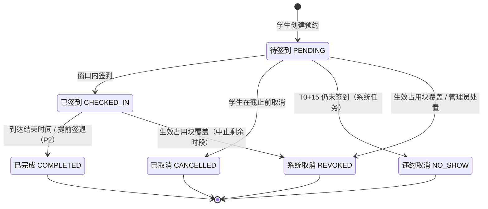

# 需求规格说明 · M1 自习座位预约（附件1）

> 本文只含 M1 模块自身的需求。来源与优先级标记、编号规则、角色总表、跨模块集成总表、非功能需求与决策记录见[需求总览](README.md)；M1 依赖的身份与权限、空间与座位主数据、通知、审计见[公共层 D](d-platform.md)。

---

## 0. 附件1 条目 → 需求映射

| 附件1 条目 | 需求编号 | 归属 |
| --- | --- | --- |
| 基本概念：自习室、座位、院系专属 | SPC-ROOM-01、SPC-ROOM-04、SPC-SEAT-01、IAM-USER-01 | D |
| 1 配置管理（自习室、开放时间、角色、权限、系统参数） | SPC-ROOM-02、SPC-ROOM-03、SPC-SEAT-02、IAM-ROLE-01 ~ 04、M1-CFG-01 | D / M1 |
| 2 预约功能 | M1-RSV-01 ~ 07 | M1 |
| 3 签到功能 | M1-CHK-01 ~ 05 | M1 |
| 4 提醒与违约记录 | M1-REM-01 ~ 03、M1-VIO-01 ~ 04、NTF-01 ~ 04 | M1 / D |
| 5 搜索与历史查询 | M1-SRH-01 ~ 04、M1-HIS-01 ~ 03 | M1 |
| 6 运营管理 | M1-OPS-01 ~ 05 | M1 |
| 7 座位特殊标记 | SPC-TAG-01 ~ 02、M1-SRH-01 | D / M1 |
| 任务书：跨模块集成、座位状态写入来源 | M1-INT-01 ~ 09、SPC-EVT-01 | M1 / D |
| 隐含：登录、服务身份、操作审计 | IAM-AUTH-01 ~ 03、AUD-01 ~ 02 | D |

---

## 1. 术语

| 术语 | 定义 |
| --- | --- |
| 空间层级 | 校区 → 楼宇 → 房间。座位隶属于房间 |
| 自习室 | 被设置为「开放自习」的房间。类型：普通教室、图书馆专用自习室、其他区域自习场地。归属：校级（统一管理）或某院系 |
| 院系专属自习室 | 归属某院系的自习室，只对该院系学生可见、可预约 |
| 座位 | 自习室内登记在册的座位，有全局唯一编号 |
| 时段（Slot） | 以整点为边界的 1 小时区间 `[h:00, h+1:00)` |
| 预约 | 学生对某个座位连续 n 个时段的占用，区间记为 `[start, end)` |
| 签到基准时刻 T0 | `T0 = max(start, 预约创建时间)`，用于计算提醒与签到截止（BR-12） |
| 签到码 | 与自习室关联、按周期轮换的动态编码，以及承载它的二维码 |
| 违约 | 预约在签到截止时刻仍未签到、被系统自动取消所产生的记录 |
| 占用块（SeatBlock） | 使一组座位在某时间区间内不可预约的记录，带写入来源与来源单号（§4.3） |
| 写入来源 | 占用块的产生方：`M1_BOOKING`（个人预约）、`M2_ROOM_BOOKING`（整教室占用）、`M3_REPAIR`（维修下架）、`ADMIN`（管理员停用） |
| 开放时间 | 自习室按星期配置的可预约时间范围，起止均为整点 |

---

## 2. 角色

| 角色 | 类型 | 说明 |
| --- | --- | --- |
| 学生 | 预置 | 查看、搜索、预约、签到、查看历史与违约 |
| 系统管理员 | 预置，不可删除 | 管理所有系统配置、角色、权限、用户；始终拥有全部权限点 |
| 教室管理员 | 预置示例，可编辑 | 在其数据范围内管理自习室、座位、开放时间、特殊标记、屏幕终端，处理异常预约 |
| 运营管理员 | 预置示例，可编辑 | 只读查看预约情况与统计数据，导出报表 |
| 屏幕终端 | 设备身份 | 绑定一个自习室，只能读取该室当前签到码 |
| 系统任务 | 内部 | 定时发送提醒、超时自动取消、记录违约、到期完成 |
| 外部模块（M2 / M3） | 服务身份 | 通过 M1 内部接口写入、释放占用块 |
| 会话代理（附加项） | 委托身份 | 以已登录用户身份调用公开接口，权限不超过该用户 |

M2、M3 的角色见各自文档，全部预置角色见需求总览 §3。M1 相关权限点见附录 A。

---

## 3. 业务规则与可调参数

> 参数均可由系统管理员在后台修改（M1-CFG-01），括号内为默认值。

| 编号 | 规则 | 来源 | 参数（默认值） |
| --- | --- | --- | --- |
| BR-01 | 预约区间起止均为整点，时长为整数小时 | `原文` | — |
| BR-02 | 单次预约时长为 1 至 N 小时 | `原文` | `m1.booking.max_hours`（4） |
| BR-03 | 预约区间须完全落在自习室当日开放时间内，不得跨日 | `细化` | — |
| BR-04 | 可预约日期为今天起 D 天内 | `拓展` | `m1.booking.advance_days`（1，即今明两天） |
| BR-05 | 可以预约「当前整点时段」，前提是该时段已过去的时间少于 X 分钟 | `决策` | `m1.booking.instant_cutoff_minutes`（30） |
| BR-06 | 同一学生的有效预约（待签到、已签到）时间不得重叠 | `细化` | — |
| BR-07 | 同一学生同时持有的有效预约数有上限 | `拓展` | `m1.booking.max_active_per_user`（2） |
| BR-08 | 同一学生首尾相接的有效预约，合并后的连续时长同样不得超过 `max_hours` | `决策` | `m1.booking.limit_consecutive`（true） |
| BR-09 | 同一座位同一时段至多一个有效预约，且不得与任何生效中的占用块重叠 | `细化` | — |
| BR-10 | 院系专属自习室仅对本院系学生可见、可预约 | `原文` | — |
| BR-11 | 学生可在签到截止前取消「待签到」预约，不计违约 | `拓展` | — |
| BR-12 | 签到基准时刻 `T0 = max(start, 创建时间)` | `细化` | — |
| BR-13 | 签到窗口为 `[start − A, T0 + B]` | `细化` / `原文` | `m1.checkin.open_before_minutes`（A=15）、`m1.checkin.deadline_minutes`（B=15） |
| BR-14 | `start − 15` 分钟发送开始前提醒（仅当创建时间早于该时刻）；`T0 + 10` 分钟仍未签到再次提醒 | `原文` | `m1.remind.before_minutes`（15）、`m1.remind.after_minutes`（10） |
| BR-15 | `T0 + B` 仍未签到：自动取消预约、释放座位、通知学生、记录 1 次违约 | `原文` | 同 BR-13 |
| BR-16 | 签到码按周期轮换，至少每天一次；轮换后旧码在宽限期内仍有效 | `原文` / `细化` | `m1.checkin.code_rotate_minutes`（1440）、`m1.checkin.code_grace_minutes`（2） |
| BR-17 | 同一学生签到码输错次数有频率上限，超限后短时锁定 | `细化` | `m1.checkin.max_failures_per_10min`（5） |
| BR-18 | 近 W 天累计违约达到 K 次，暂停预约 S 天 | `拓展` / `决策` | `m1.violation.window_days`（30）、`m1.violation.threshold`（3）、`m1.violation.suspend_days`（7） |
| BR-19 | 非学生原因导致的取消（维修下架、整间占用、管理员停用或缩短开放时间）不计违约，必须通知学生 | `细化` | — |
| BR-20 | 已签到预约到达结束时间自动置为「已完成」 | `细化` | — |
| BR-21 | 时长、范围类参数只在创建预约时校验，不追溯已有预约；提醒、签到类时间参数以预约创建时的取值为准（创建时快照） | `决策` | — |
| BR-22 | 开放时间的起止必须为整点 | `细化` | — |
| BR-23 | 所有业务时间按 Asia/Shanghai 解释，存储带时区 | `细化` | — |

**时间线示例**（默认参数）：

| 场景 | 预约 | 时刻 → 系统行为 |
| --- | --- | --- |
| 普通预约 | 12:00 创建，14:00–16:00 | 12:00 预约成功通知 → 13:45 开始前提醒、签到窗口开启 → 14:10 未签到则二次提醒 → 14:15 仍未签到则自动取消、记违约、通知，座位立即释放 |
| 即时预约 | 14:12 创建，14:00–16:00（BR-05 允许） | T0 = 14:12，不发开始前提醒，窗口立即开启 → 14:22 未签到则提醒 → 14:27 仍未签到则自动取消并记违约 |

---

## 4. 核心模型

### 4.1 预约状态机

| 转换 | 触发者 | 副作用 |
| --- | --- | --- |
| 创建 → 待签到 | 学生 | 写入 `M1_BOOKING` 占用；发送「预约成功」；登记提醒与截止任务 |
| 待签到 → 已签到 | 学生 | 记录签到时间与方式（编码 / 扫码 / 补签） |
| 待签到 → 已取消 | 学生 | 释放占用；不计违约 |
| 待签到 → 违约取消 | 系统任务 | 释放占用；生成违约记录；通知；重新计算处罚状态 |
| 待签到 / 已签到 → 系统取消 | 占用块写入方、管理员 | 释放占用；记录取消来源与来源单号；通知；不计违约 |
| 已签到 → 已完成 | 系统任务 / 学生签退 | 签退时自下一整点起释放剩余时段 |

### 4.2 座位可用性判定

座位 s 在时段 t 对学生 u **可预约**，当且仅当：

1. 座位 s 与其所在房间均为「启用」，且房间已开放为自习室；
2. t 落在该房间当日开放时间内；
3. 学生 u 有权看到该自习室（BR-10）；
4. 不存在覆盖 (s, t) 的生效占用块（任何写入来源）。

不可预约时，对学生展示的原因按以下优先级取第一个命中项：**不开放 > 停用 > 维修下架 > 整间占用 > 已被预约**。展示「已被预约」时不暴露预约人身份。

### 4.3 占用块与写入来源

任务书要求「M1 的座位状态必须记录写入来源」。M1 用统一的**占用块**表达一切使座位不可预约的原因：

| 字段 | 说明 |
| --- | --- |
| 作用范围 | 整间（某房间的全部座位）或指定座位列表 |
| 时间区间 | `[from, to)`；`to` 可为空，表示直到被释放（仅 `M3_REPAIR`、`ADMIN` 允许） |
| 写入来源 | `M1_BOOKING` / `M2_ROOM_BOOKING` / `M3_REPAIR` / `ADMIN` |
| 来源单号 | 预约号 / 整教室申请号 / 报修工单号 / 管理操作单号；与写入来源一起构成幂等键 |
| 类型 | `HOLD`（预占：阻止新预约，不影响已有预约）/ `ACTIVE`（生效：阻止新预约，并取消冲突的已有预约） |
| 状态 | 生效中 / 已释放 |
| 审计字段 | 写入方（用户或服务）、写入时间、释放时间、释放原因 |

每次占用块的写入、升级、释放都追加一条**座位状态变更日志**（只增不改），供追溯与验收（M1-INT-06）。

---

## 5. 功能需求

### 5.1 业务参数（M1-CFG）——附件1 第 1、2 条

#### M1-CFG-01 业务参数管理
`P0` `原文`（「系统参数可调」） · 验证：单元 + 集成

系统管理员可查看、修改 §3 中的 `m1.*` 参数。每个参数有取值范围校验；修改写入审计；生效规则见 BR-21。

- 验收标准
  1. 给定 `max_hours` 从 4 改为 3，当学生新建 4 小时预约时，则被拒绝；修改前已有的 4 小时预约不受影响。
  2. 给定输入 `max_hours = 0` 或超过 12，当保存时，则被拒绝并提示合法范围。

### 5.2 预约（M1-RSV）——附件1 第 2 条

#### M1-RSV-01 查看可用自习室
`P0` `原文` · 验证：集成 + E2E

学生按日期与时段浏览自己可见、已开放的自习室，每个显示：名称、位置、类型、开放时间、标记座位数、所选时段可约座位数。

- 验收标准
  1. 给定存在已关闭、已停用、其他院系专属的自习室，当学生浏览时，则这些自习室都不出现。
  2. 给定所选时段，则显示的可约座位数等于按 §4.2 判定为可预约的座位数。

#### M1-RSV-02 创建预约
`P0` `原文` · 验证：单元 + 集成 + E2E

学生选择座位、日期、开始整点与时长提交。系统按 BR-01 ~ BR-10 与处罚状态校验；成功后预约进入「待签到」，返回预约号，发送「预约成功」通知。创建请求支持幂等键。

- 验收标准
  1. 给定默认参数，当预约 14:00–18:00 时，则成功；当预约 14:00–19:00 时，则被拒绝并提示单次上限 4 小时。
  2. 给定开始时间 14:30，当提交时，则被拒绝（非整点）。
  3. 给定本人已有 15:00–16:00 的有效预约，当预约另一座位 14:00–16:00 时，则被拒绝（BR-06）。
  4. 给定本人已有 10:00–14:00 的有效预约，当预约 14:00–15:00 时，则被拒绝（BR-08，合并后 5 小时）。
  5. 给定两名学生并发预约同一座位同一时段，则恰好一人成功，另一人收到「该时段已被预约」。
  6. 给定同一幂等键重复提交，则只产生一条预约。
  7. 给定学生处于预约暂停期，当提交时，则被拒绝并提示恢复日期。
  8. 给定 14:40 预约 14:00–15:00（已过 40 分钟，超过 BR-05 的 30 分钟），当提交时，则被拒绝。

#### M1-RSV-03 取消预约
`P0` `拓展` · 验证：集成

学生可在签到截止前取消「待签到」预约，不计违约，座位立即释放。

- 验收标准
  1. 给定取消成功，当他人搜索同一座位同一时段时，则立即显示可约。
  2. 给定预约已签到，当取消时，则被拒绝（使用中请用签退，M1-RSV-06）。

#### M1-RSV-04 我的预约
`P0` `细化` · 验证：E2E

学生查看当前与即将开始的预约：状态、签到窗口开启与截止的倒计时、签到入口、取消入口。

#### M1-RSV-05 预约自动完成
`P0` `细化` · 验证：单元 + 集成

已签到的预约到达结束时间后自动置为「已完成」（BR-20）。

- 验收标准
  1. 给定 14:00–16:00 已签到的预约，当时间到达 16:00 后 1 分钟内，则状态为「已完成」。

#### M1-RSV-06 提前签退
`P2` `拓展` · 验证：集成

使用中可签退，自下一个整点起释放剩余时段，状态为「已完成（提前签退）」。

- 验收标准
  1. 给定 14:00–18:00 已签到的预约在 15:20 签退，则 16:00–18:00 立即可被他人预约。

#### M1-RSV-07 管理员处置预约
`P1` `拓展` · 验证：集成

教室管理员可在数据范围内取消某条预约（原因必填），按 BR-19 通知学生、不计违约，写入审计。

### 5.3 签到（M1-CHK）——附件1 第 3 条

#### M1-CHK-01 签到码生成与轮换
`P0` `原文` · 验证：单元 + 集成

系统为每个开放的自习室按 BR-16 生成签到码：6 位，取自去除了易混字符（0/O、1/I/L）的字母数字集，用安全随机数生成，不可预测。

- 验收标准
  1. 给定默认参数，当每天 00:00 之后取码时，则得到与前一天不同的新码。
  2. 给定两个自习室，则同一时刻的签到码相互独立。
  3. 给定码刚轮换，当学生在宽限期内输入旧码时，则仍可签到。

#### M1-CHK-02 自习室屏幕端
`P0` `原文` · 验证：E2E

屏幕页面全屏显示：自习室名称、日期、当前签到码、二维码（内容为带房间与签到码参数的签到网址）、距下次换码的倒计时。页面自动刷新，换码后 30 秒内可见。屏幕使用设备令牌访问，令牌由教室管理员为该室生成，可吊销。

- 验收标准
  1. 给定签到码轮换，则屏幕在 30 秒内显示新码与新二维码。
  2. 给定设备令牌被吊销，当屏幕再次取码时，则被拒绝。
  3. 给定 A 室的设备令牌，当请求 B 室签到码时，则被拒绝。

#### M1-CHK-03 输入编码签到（Web）
`P0` `原文` · 验证：单元 + 集成 + E2E

学生在预约详情或签到页输入签到码完成签到。校验：预约属于本人；状态为「待签到」；当前时间在签到窗口内（BR-13）；签到码属于该预约所在自习室且有效（BR-16）；未超过错误次数限制（BR-17）。

- 验收标准
  1. 给定窗口内输入正确码，则状态变为「已签到」，并记录签到时间与方式「编码」。
  2. 给定输入的是其他自习室的码，则失败并提示「签到码与预约自习室不符」。
  3. 给定 14:00 的预约，当在 13:40 签到时，则失败并提示窗口将于 13:45 开启。
  4. 给定 10 分钟内已输错 5 次，当第 6 次输入（即使正确）时，则被拒绝并提示稍后再试。

#### M1-CHK-04 扫码签到
`P0` `原文` · 验证：E2E

学生用手机相机扫描屏幕上的二维码，打开签到网址；系统识别本人在该自习室处于签到窗口内的预约，学生一键确认即可签到，无需手动输码。未登录时先登录，登录后回到签到页。（学生端形态见决策 Q1。）

- 验收标准
  1. 给定本人在该室有窗口内的预约，当扫码并确认时，则签到成功，方式记录为「扫码」。
  2. 给定本人在该室没有窗口内的预约，当扫码时，则提示原因并提供「去预约」入口。

#### M1-CHK-05 管理员补签
`P2` `拓展` · 验证：集成

屏幕故障等异常情况下，教室管理员可为学生补签（原因必填，写入审计）。

### 5.4 提醒（M1-REM）——附件1 第 4 条

#### M1-REM-01 开始前提醒
`P0` `原文` · 验证：单元 + 集成

在 `start − 15` 分钟发送提醒，内容含自习室、座位、时段与签到方式。若预约创建时已晚于该时刻则不发送。

- 验收标准
  1. 给定 13:00 创建的 14:00 预约，则在 13:45（误差 ≤ 1 分钟）收到提醒。
  2. 给定 13:50 创建的 14:00 预约，则不会收到开始前提醒。
  3. 给定预约在 13:40 已被取消，则不会收到提醒。

#### M1-REM-02 未签到提醒
`P0` `原文` · 验证：单元 + 集成

`T0 + 10` 分钟仍未签到，再次提醒，并告知距自动取消的剩余时间。

- 验收标准
  1. 给定 14:00 的预约到 14:10 仍未签到，则收到提醒。
  2. 给定 14:08 已签到，则不发送。

#### M1-REM-03 定时任务可靠性
`P0` `细化` · 验证：集成

提醒、超时取消、自动完成等任务按分钟粒度执行，误差 ≤ 1 分钟。多实例部署或服务重启时不漏发、不重发（以「预约号 + 事件类型」为幂等键）。宕机恢复后补偿处理错过的到期项；对已经失去意义的提醒（如开始时间已过的开始前提醒）跳过不发。

- 验收标准
  1. 给定在 13:44–13:46 之间重启服务，则 13:45 的提醒仍恰好发送一次。
  2. 给定同时运行两个服务实例，则每条提醒只发送一次。

### 5.5 违约（M1-VIO）——附件1 第 4 条

#### M1-VIO-01 超时自动取消与违约记录
`P0` `原文` · 验证：单元 + 集成 + E2E

`T0 + 15` 分钟仍未签到：预约置为「违约取消」，释放座位，通知学生，生成违约记录（预约号、自习室、座位、时段、时间、原因）。

- 验收标准
  1. 给定 14:00 的预约到 14:15 仍未签到，则在 14:16 前状态变为「违约取消」，并生成 1 条违约记录。
  2. 给定释放完成，则他人可立即预约该座位 15:00 起的时段，以及（按 BR-05）14:00–15:00 时段。
  3. 给定 14:14 签到成功，则不产生违约。

#### M1-VIO-02 违约查询
`P0` `细化` · 验证：集成 + E2E

学生查看本人违约记录与当前处罚状态；管理员在数据范围内按学生、时间、自习室查询违约。

#### M1-VIO-03 违约处罚
`P1` `拓展` / `决策` · 验证：单元 + 集成

按 BR-18 自动暂停预约，到期自动解除；暂停生效与解除都发送通知。

- 验收标准
  1. 给定 30 天内第 3 次违约，当该生再预约时，则被拒绝并提示恢复日期。
  2. 给定暂停到期，则该生可正常预约。

#### M1-VIO-04 违约撤销
`P1` `拓展` · 验证：集成

管理员可撤销某条违约（原因必填，写入审计），撤销后重新计算处罚状态。

- 验收标准
  1. 给定撤销后近 30 天违约降为 2 次，则暂停立即解除。

### 5.6 搜索（M1-SRH）——附件1 第 5、7 条

#### M1-SRH-01 条件搜索座位
`P0` `原文` · 验证：集成 + E2E

搜索条件：

| 条件 | 说明 |
| --- | --- |
| 日期 | 必填，默认今天 |
| 开始整点 + 时长 | 默认最近可约整点、1 小时 |
| 校区 / 楼宇 / 自习室 | 可选，逐级筛选 |
| 自习室类型 | 普通教室 / 图书馆自习室 / 其他 |
| 座位标记 | 多选时须全部满足；另有快捷条件「有插座（任一类型）」 |
| 仅看可约 | 默认开启 |
| 关键字 | 自习室名称或座位编号 |

结果按自习室分组，显示可约座位数与座位列表（编号、标记、所选时段状态）。

- 验收标准
  1. 给定条件「固定插座」与 14:00–16:00，则结果中每个座位都带该标记，且在整个区间内可约。
  2. 给定任意条件，则结果中不包含学生不可见的自习室。
  3. 给定 50 个自习室、5000 个座位的数据量，则搜索 P95 < 1 秒（测试环境）。

#### M1-SRH-02 座位时间轴
`P1` `细化` · 验证：E2E

查看单个座位当日各整点时段的状态（可约 / 已约 / 不可用及原因类别），不显示他人身份。

#### M1-SRH-03 座位图
`P2` `拓展` · 验证：E2E

按平面位置显示自习室座位及状态（依赖 SPC-SEAT-03）。

#### M1-SRH-04 替代推荐
`P2` `拓展` · 验证：集成

所选座位不可约时，推荐同一自习室、相同标记的可约座位。

### 5.7 历史（M1-HIS）——附件1 第 5 条

#### M1-HIS-01 历史预约查询
`P0` `原文` · 验证：集成 + E2E

学生分页查看本人全部预约（按时间倒序），可按状态、日期区间筛选；显示自习室、座位、时段、状态、签到时间、取消原因。

- 验收标准
  1. 给定座位已被注销，则历史记录仍显示当时的座位编号与自习室名称。

#### M1-HIS-02 再次预约
`P0` `原文`（「历史复用」） · 验证：E2E

从历史记录一键「再次预约该座位」，自动带入座位，学生只需选择日期与时段。若该座位已停用、注销或学生已无权限，提示原因并返回搜索（有 M1-SRH-04 时给出推荐）。

- 验收标准
  1. 给定点击「再次预约」，则进入预约表单且座位已预填；选择可约时段提交即成功。
  2. 给定该座位已注销，则提示「座位已不可用」并跳转搜索。

#### M1-HIS-03 常用座位
`P2` `拓展` · 验证：E2E

收藏座位，在首页快速预约。

### 5.8 运营管理（M1-OPS）——附件1 第 6 条

#### M1-OPS-01 实时看板
`P0` `原文` · 验证：集成 + E2E

按楼宇、自习室显示当前时段：总座位、不可用、已预约未签到、已签到、空闲。数据延迟 ≤ 1 分钟。

#### M1-OPS-02 预约明细
`P0` `原文` · 验证：集成

按日期区间、自习室、状态查询预约明细。学生身份信息按权限显示：运营管理员默认看到脱敏学号、不显示姓名（见 NFR-11）。

#### M1-OPS-03 统计指标
`P0` `细化` · 验证：单元 + 集成

按日期区间与范围（全校 / 楼宇 / 自习室）输出以下指标，口径固定：

| 指标 | 口径 |
| --- | --- |
| 开放座位小时 | Σ（座位 × 开放小时），扣除停用、维修下架、整间占用的座位小时 |
| 预约率 | 被个人预约的座位小时 ÷ 开放座位小时 |
| 实际使用率 | 已签到预约的座位小时 ÷ 开放座位小时 |
| 签到率 | 已签到预约数 ÷（已签到 + 违约取消）预约数 |
| 违约率 | 违约取消数 ÷（已签到 + 违约取消）预约数 |
| 日均周转次数 | 已签到预约数 ÷ 座位数 ÷ 天数 |
| 时段热力图 | 星期 × 整点 的预约率矩阵 |

- 验收标准
  1. 给定一份固定的种子数据集，则各指标的计算结果与预先手算的期望值一致（期望值固化为测试用例）。

#### M1-OPS-04 低利用率与紧张识别
`P1` `拓展` · 验证：集成

标记统计周期内实际使用率低于阈值（`m1.ops.low_usage_threshold`，默认 30%）的自习室，以及预约率持续高于 90% 的紧张自习室，为增减自习室提供依据。

#### M1-OPS-05 导出
`P1` `拓展` · 验证：集成

预约明细与统计结果导出为 CSV（遵循同样的脱敏规则）。

### 5.9 跨模块集成（M1-INT）——任务书第二节

> 任务书要求：M3「维修中」工单使该室全部座位下架、验收通过后恢复；M2 审批通过后占用该室时段内全部座位、驳回或超时撤销后回滚；M1 座位状态记录写入来源。下面把这些要求落成 M1 对外提供的接口语义，M2、M3 只需按语义调用。

#### M1-INT-01 占用块写入
`P0` `原文` · 验证：集成 + 契约

M1 提供内部接口，供 M2、M3（以及管理员功能）写入占用块，参数：作用范围（整间 / 指定座位）、时间区间（M3 可不填结束时间）、写入来源、来源单号、类型（`HOLD` / `ACTIVE`）。以「写入来源 + 来源单号」为幂等键：重复写入相同内容返回相同结果，内容变化（如 `HOLD` 升级为 `ACTIVE`、区间变化）视为更新。

- 验收标准
  1. 给定同一请求重复调用 3 次，则只存在 1 个占用块，3 次响应一致。
  2. 给定写入成功，则该室全部座位在区间内搜索为不可约，原因显示「维修下架」或「整间占用」。
  3. 给定 `HOLD` 升级为 `ACTIVE`，则冲突处理按 M1-INT-03 执行。

#### M1-INT-02 占用块释放
`P0` `原文` · 验证：集成 + 契约

按「写入来源 + 来源单号」释放占用块；释放不存在或已释放的块返回成功（幂等）。释放后，若座位上没有其他生效块，即恢复可约；此前因该块被取消的个人预约**不自动恢复**。

- 验收标准
  1. 给定同一自习室有两张「维修中」工单，当其中一张验收通过并释放时，则该室仍不可约；两张都释放后恢复可约。
  2. 给定重复调用释放，则均返回成功，状态日志只有一条释放记录。

#### M1-INT-03 冲突处理
`P0` `细化` / `决策` · 验证：集成

- `ACTIVE` 块写入（或由 `HOLD` 升级）时，与之重叠的「待签到」「已签到」个人预约全部被系统取消：状态置为「系统取消」，记录来源与来源单号，通知学生，不计违约（BR-19）；接口响应返回被取消的预约清单（不含学生身份）。
- 「已签到」预约被取消时只中止剩余时段，已使用时段仍计入统计。
- `HOLD` 块只阻止新的个人预约，不取消已有预约。

- 验收标准
  1. 给定某室 14:00–16:00 有 3 条个人预约，当写入覆盖该区间的 `ACTIVE` 块时，则 3 条预约变为「系统取消」，3 位学生收到通知，均无违约，响应中列出 3 个预约号。
  2. 给定写入 `HOLD` 块，则已有预约保持不变，新预约被拒绝并提示「该时段已被整间占用」。

#### M1-INT-04 可用性与冲突查询
`P0` `细化` · 验证：集成 + 契约

查询某自习室在给定区间内的占用块与冲突个人预约数量（不含学生身份），供 M2 在提交、审批前展示冲突。

#### M1-INT-05 主数据变更处理
`P0` `细化` · 验证：集成

订阅 SPC-EVT-01 事件。房间关闭或停用、座位停用或注销、开放时间缩短时，按 BR-19 处理受影响预约。

- 验收标准
  1. 给定开放时间从 22:00 缩短到 20:00，则 20:00 之后的预约被系统取消并通知，均不计违约。

#### M1-INT-06 状态来源追溯
`P0` `原文` · 验证：集成 + E2E

管理员可查询任意座位在任意时刻的状态及来源（写入来源 + 来源单号 + 写入时间 + 写入方），以及座位状态变更历史。

- 验收标准
  1. 给定一个先被 M3 下架、后恢复的座位，则追溯结果按时间列出「下架（M3_REPAIR，工单号，时间）→ 恢复（M3_REPAIR，工单号，时间）」。

#### M1-INT-07 违约摘要接口
`P2` `拓展` · 验证：契约

向 M2 提供学生近期违约摘要，供 M2 的「权限门槛」可选使用。

#### M1-INT-08 一键报修入口
`P2` `拓展` · 验证：E2E

学生在预约详情页对座位或自习室发起报修：跳转 M3 上报页，并预填位置。

#### M1-INT-09 面向代理的公开接口
`P1` `细化`（附加项前提） · 验证：契约

学生侧能力（查询可约座位、创建 / 取消预约、查询预约与历史、查询签到状态）都通过有 OpenAPI 描述的公开接口提供；错误码语义明确，能让调用方区分「参数缺失」「规则不满足」「资源冲突」，以便代理据此追问用户而不是擅自执行。

---

## 6. 需求追踪矩阵

> 「实现」列填写合并请求或代码位置，「状态」取值：未开始 / 进行中 / 已完成 / 已验证 / 延期（须注明原因）。需求不得从本表删除。

| 需求 | 优先级 | 归属 | 计划验证 | 实现 | 状态 |
| --- | --- | --- | --- | --- | --- |
| M1-CFG-01 | P0 | M1 | 单元、集成 | | 未开始 |
| M1-RSV-01 | P0 | M1 | 集成、E2E | | 未开始 |
| M1-RSV-02 | P0 | M1 | 单元、集成、E2E | | 未开始 |
| M1-RSV-03 | P0 | M1 | 集成 | | 未开始 |
| M1-RSV-04 | P0 | M1 | E2E | | 未开始 |
| M1-RSV-05 | P0 | M1 | 单元、集成 | | 未开始 |
| M1-RSV-06 | P2 | M1 | 集成 | | 未开始 |
| M1-RSV-07 | P1 | M1 | 集成 | | 未开始 |
| M1-CHK-01 | P0 | M1 | 单元、集成 | | 未开始 |
| M1-CHK-02 | P0 | M1 | E2E | | 未开始 |
| M1-CHK-03 | P0 | M1 | 单元、集成、E2E | | 未开始 |
| M1-CHK-04 | P0 | M1 | E2E | | 未开始 |
| M1-CHK-05 | P2 | M1 | 集成 | | 未开始 |
| M1-REM-01 | P0 | M1 | 单元、集成 | | 未开始 |
| M1-REM-02 | P0 | M1 | 单元、集成 | | 未开始 |
| M1-REM-03 | P0 | M1 | 集成 | | 未开始 |
| M1-VIO-01 | P0 | M1 | 单元、集成、E2E | | 未开始 |
| M1-VIO-02 | P0 | M1 | 集成、E2E | | 未开始 |
| M1-VIO-03 | P1 | M1 | 单元、集成 | | 未开始 |
| M1-VIO-04 | P1 | M1 | 集成 | | 未开始 |
| M1-SRH-01 | P0 | M1 | 集成、E2E | | 未开始 |
| M1-SRH-02 | P1 | M1 | E2E | | 未开始 |
| M1-SRH-03 | P2 | M1 | E2E | | 未开始 |
| M1-SRH-04 | P2 | M1 | 集成 | | 未开始 |
| M1-HIS-01 | P0 | M1 | 集成、E2E | | 未开始 |
| M1-HIS-02 | P0 | M1 | E2E | | 未开始 |
| M1-HIS-03 | P2 | M1 | E2E | | 未开始 |
| M1-OPS-01 | P0 | M1 | 集成、E2E | | 未开始 |
| M1-OPS-02 | P0 | M1 | 集成 | | 未开始 |
| M1-OPS-03 | P0 | M1 | 单元、集成 | | 未开始 |
| M1-OPS-04 | P1 | M1 | 集成 | | 未开始 |
| M1-OPS-05 | P1 | M1 | 集成 | | 未开始 |
| M1-INT-01 | P0 | M1 | 集成、契约 | | 未开始 |
| M1-INT-02 | P0 | M1 | 集成、契约 | | 未开始 |
| M1-INT-03 | P0 | M1 | 集成 | | 未开始 |
| M1-INT-04 | P0 | M1 | 集成、契约 | | 未开始 |
| M1-INT-05 | P0 | M1 | 集成 | | 未开始 |
| M1-INT-06 | P0 | M1 | 集成、E2E | | 未开始 |
| M1-INT-07 | P2 | M1 | 契约 | | 未开始 |
| M1-INT-08 | P2 | M1 | E2E | | 未开始 |
| M1-INT-09 | P1 | M1 | 契约 | | 未开始 |

统计：共 41 条，其中 P0 27 条、P1 7 条、P2 7 条。

---

## 附录 A：M1 权限点与预置角色

| 权限点 | 说明 | 学生 | 教室管理员 | 运营管理员 | 系统管理员 |
| --- | --- | :-: | :-: | :-: | :-: |
| `m1:seat:search` | 浏览自习室、搜索座位、查看时间轴 | ✓ | ✓ | ✓ | ✓ |
| `m1:booking:create` | 创建预约 | ✓ | | | ✓ |
| `m1:booking:cancel-own` | 取消本人预约 | ✓ | | | ✓ |
| `m1:booking:view-own` | 查看本人预约与历史 | ✓ | | | ✓ |
| `m1:checkin:do` | 签到、签退 | ✓ | | | ✓ |
| `m1:violation:view-own` | 查看本人违约 | ✓ | | | ✓ |
| `m1:booking:view-all` | 查看范围内预约明细 | | ✓ | ✓ | ✓ |
| `m1:booking:cancel-any` | 处置范围内预约 | | ✓ | | ✓ |
| `m1:checkin:manual` | 补签（P2） | | ✓ | | ✓ |
| `m1:violation:view-all` | 查看范围内违约 | | ✓ | ✓ | ✓ |
| `m1:violation:revoke` | 撤销违约 | | ✓ | | ✓ |
| `m1:stats:view` | 看板与统计 | | ✓ | ✓ | ✓ |
| `m1:stats:export` | 导出 | | | ✓ | ✓ |
| `m1:screen:manage` | 生成、吊销屏幕设备令牌 | | ✓ | | ✓ |
| `m1:trace:view` | 座位状态来源追溯 | | ✓ | ✓ | ✓ |
| `m1:setting:manage` | 修改 M1 业务参数 | | | | ✓ |

另有服务权限 `m1:block:write`（占用块写入与释放），只授予 M2、M3 的服务身份与管理员功能所在服务，不授予任何用户角色。

公共层权限点见[公共层 D](d-platform.md) 附录 A。

---

## 附录 B：变更记录

| 版本 | 日期 | 变更 |
| --- | --- | --- |
| v0.1 | 2026-10-17 | 初稿：附件1 全部功能的拓展、细化、明确 |
| v0.2 | 2026-10-17 | 公共层需求移至 `d-platform.md`；通用约定、非功能需求、跨模块集成与决策记录移至 `README.md`；待决策项按推荐方案定案 |
