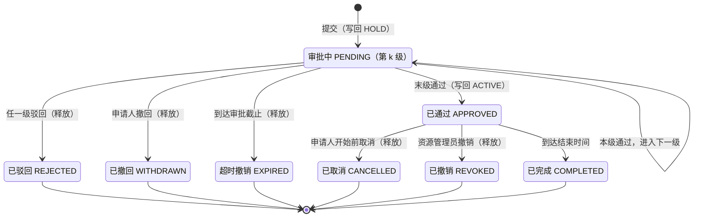

# 需求规格说明 · M2 整教室预约与审批

> 本文只含 M2 模块自身的需求。来源与优先级标记、编号规则、角色总表、跨模块集成总表、非功能需求与决策记录见[需求总览](README.md)；M2 依赖的身份与权限、空间主数据、通知、审计见[公共层 D](d-platform.md)；M2 写回 M1 所用接口的语义见 [M1 需求](m1-seat-reservation.md) §5.9。

---

## 0. 任务书条目 → 需求映射

| 任务书条目 | 需求编号 |
| --- | --- |
| 权限门槛 | M2-ELG-01 ~ 05 |
| 申请提交 | M2-ROOM-01 ~ 02、M2-APP-01 ~ 06 |
| 多级审批（通过 / 驳回） | M2-APV-01 ~ 06、M2-FLOW-01 ~ 02 |
| 超时自动撤销 | M2-TMO-01 ~ 03 |
| M2 → M1：审批通过占用全部座位，驳回或超时撤销后回滚 | M2-INT-01 ~ 03 |
| 附加项：提交申请、查询申请状态、撤销申请 | M2-INT-05、M2-APP-01、M2-APP-03、M2-QRY-01 |
| 补充集成点：维修影响、主数据变更 | M2-INT-04、M2-INT-06 |

---

## 1. 术语

| 术语 | 定义 |
| --- | --- |
| 整教室预约申请 | 申请人对某个房间某一时段整间使用的申请，简称「申请」 |
| 可整间预约房间 | 在空间主数据中被标记为允许整间预约的房间（SPC-ROOM-05），可以是自习室，也可以是普通教室、会议室 |
| 审批链 | 按规则匹配得到的有序审批级别列表，提交时固化到申请上 |
| 审批级别 | 审批链中的一级：指定审批角色，以及审批人数据范围的取法（如「申请人所在院系」「房间所在楼宇」） |
| 当前级别 | 申请正在等待处理的那一级 |
| 级别处理时限 | 每一级允许的最长处理时间 |
| 审批截止时刻 | `min(进入当前级别的时刻 + 级别处理时限, 使用开始时间 − 开始保护期)`（BR-M2-11） |
| 写回状态 | 本申请在 M1 中的占用同步情况：同步中 / 已同步 / 同步失败 |

---

## 2. 角色

| 角色 | 说明 |
| --- | --- |
| 教职工 | 可申请；预置角色 |
| 学生组织负责人 | 可申请；由系统管理员为学生授予（如社团负责人、学生会干部） |
| 院系审批人 | 审批与本院系相关的级别（如学生申请的第一级）；数据范围为院系 |
| 教室管理员 | 审批其数据范围内房间的使用 |
| 资源管理员 | 校级终审（大型活动、长时段）；可撤销已通过的申请；查看全部申请 |
| 系统管理员 | 维护审批链；处理写回失败 |
| 系统任务 | 超时撤销、截止提醒、到期完成 |
| M1（服务） | 提供占用块写入 / 释放与可用性查询接口 |

权限点见附录 A，全部预置角色见需求总览 §3。

---

## 3. 业务规则与可调参数

| 编号 | 规则 | 来源 | 参数（默认值） |
| --- | --- | --- | --- |
| BR-M2-01 | 申请时段起止均为整点，时长 1 至 N 小时（与 M1 时段对齐） | `细化` | `m2.max_duration_hours`（8） |
| BR-M2-02 | 申请时段须完全落在该房间当日开放时间内，不得跨日 | `细化` | — |
| BR-M2-03 | 至少提前 X 小时、至多提前 Y 天提交 | `拓展` | `m2.lead_min_hours`（24）、`m2.lead_max_days`（14） |
| BR-M2-04 | 同一房间同一时段，同时至多存在一个「审批中」或「已通过」的申请；先提交者占先，与之冲突的新申请不能提交 | `决策` | — |
| BR-M2-05 | 房间存在生效中的维修下架时不能提交 | `细化` | — |
| BR-M2-06 | 预计人数不得超过房间容量 | `细化` | — |
| BR-M2-07 | 每名申请人同时持有的「审批中 + 已通过未结束」申请数有上限 | `拓展` | `m2.max_active_per_user`（3） |
| BR-M2-08 | 申请人不能审批自己的申请；同一人不能在同一申请中审批两级 | `细化` | — |
| BR-M2-09 | 审批链按规则匹配：条件为申请人身份、房间归属与类型、时长、预计人数；按优先级取第一条命中的规则 | `细化` | 预置规则见 §4.2 |
| BR-M2-10 | 任一级驳回即整单驳回，驳回理由必填 | `原文` / `细化` | — |
| BR-M2-11 | 审批截止时刻 = `min(进入当前级别时刻 + H, 开始时间 − G)`；到截止仍未处理，申请自动超时撤销 | `原文` / `决策` | `m2.level_timeout_hours`（H=24）、`m2.start_guard_hours`（G=2） |
| BR-M2-12 | 审批截止前 R 小时提醒当前级别审批人 | `拓展` | `m2.approve_remind_hours`（4） |
| BR-M2-13 | 终审前申请人可撤回；终审通过后、开始前可取消；开始后不能取消 | `细化` | — |
| BR-M2-14 | 写回映射：提交 → `HOLD`；终审通过 → `ACTIVE`；驳回、撤回、超时撤销、取消、管理员撤销 → 释放 | `决策` | — |
| BR-M2-15 | 写回失败不阻塞 M2 自身状态变更；后台按退避重试，直至成功或人工处理 | `细化` | `m2.writeback.max_retries`（10） |
| BR-M2-16 | 无论房间是否开放为自习室都写回 M1，由 M1 判断影响哪些座位 | `决策` | — |
| BR-M2-17 | 房间须为可整间预约房间，申请人身份须在该房间允许的申请身份内；院系房间仅限本院系人员 | `原文`（权限门槛） / `细化` | — |
| BR-M2-18 | 近 30 天 M1 违约达到 3 次的学生不能申请 | `拓展` | `m2.credit.violation_threshold`（3） |
| BR-M2-19 | 时长、提前量等参数只在提交时校验；审批时限以进入该级别时的参数为准 | `决策` | — |

**超时示例**（默认参数）：

| 场景 | 时刻 → 系统行为 |
| --- | --- |
| 充裕 | 10-20 09:00 提交，使用 10-25 14:00，两级审批 → 第 1 级截止 10-21 09:00；若 10-20 15:00 第 1 级通过，第 2 级截止 10-21 15:00 |
| 临近开始 | 10-20 08:00 提交，使用 10-21 08:00 → 第 1 级截止 = min(10-21 08:00, 10-21 06:00) = 10-21 06:00 |
| 超时 | 第 1 级截止前 4 小时提醒审批人 → 到截止仍未处理，1 分钟内置为「超时撤销」，释放 M1 预占，通知申请人与该级审批人 |

---

## 4. 核心模型

### 4.1 申请状态机

| 转换 | 触发者 | 副作用 |
| --- | --- | --- |
| 提交 → 审批中（第 1 级） | 申请人 | 固化审批链快照；写回 `HOLD`；通知第 1 级审批人 |
| 审批中（第 k 级）→ 第 k+1 级 | 第 k 级审批人 | 记录审批；重新计算截止时刻；通知下一级审批人 |
| 审批中 → 已通过 | 末级审批人 | 写回升级为 `ACTIVE`（M1 取消冲突个人预约）；通知申请人 |
| 审批中 → 已驳回 / 已撤回 / 超时撤销 | 审批人 / 申请人 / 系统任务 | 释放占用；通知相关方 |
| 已通过 → 已取消 / 已撤销 | 申请人 / 资源管理员 | 释放占用；被 M1 取消的个人预约不恢复；通知相关方 |
| 已通过 → 已完成 | 系统任务 | 无需写回（占用块区间自然结束） |

### 4.2 预置审批链

| 优先级 | 条件 | 审批链 |
| --- | --- | --- |
| 1 | 申请人为学生组织负责人，且（预计人数 > 100 或时长 > 4 小时） | 院系审批人（申请人所在院系）→ 教室管理员（房间所在范围）→ 资源管理员 |
| 2 | 申请人为学生组织负责人 | 院系审批人（申请人所在院系）→ 教室管理员（房间所在范围） |
| 3 | 申请人为教职工，且（预计人数 > 100 或时长 > 4 小时） | 教室管理员（房间所在范围）→ 资源管理员 |
| 4 | 其他 | 教室管理员（房间所在范围） |

某一级的**审批人**是同时满足「拥有该级角色」与「数据范围覆盖该级取值」的全部用户，其中任一人处理即可。

---

## 5. 功能需求

### 5.1 房间检索（M2-ROOM）

#### M2-ROOM-01 可申请房间检索
`P0` `细化` · 验证：集成 + E2E

申请人按日期、时段、楼宇、房间类型、最小容量（≥ 预计人数）检索房间。只返回申请人有资格申请的可整间预约房间（BR-M2-17），显示名称、位置、容量、开放时间、所选时段是否可申请及不可申请的原因（已有申请 / 维修下架 / 不在开放时间）。

- 验收标准
  1. 给定某房间未标记为可整间预约，则检索结果中不出现该房间。
  2. 给定院系 X 的专属房间，则院系 Y 的申请人检索不到。
  3. 给定预计人数 60，则容量小于 60 的房间被过滤。

#### M2-ROOM-02 房间占用日历
`P1` `拓展` · 验证：E2E

查看某房间一天或一周的占用：整间申请（审批中 / 已通过，只显示时段与状态，不显示申请人）、维修下架、个人预约数量（来自 M1-INT-04）。

### 5.2 准入校验（M2-ELG）——任务书「权限门槛」

> 每一项门槛不满足时，接口返回明确的错误码与原因，前端与会话代理据此向用户说明。

#### M2-ELG-01 申请权限
`P0` `原文` · 验证：集成

只有拥有 `m2:application:create` 权限点的用户可以申请（预置授予教职工、学生组织负责人）。

- 验收标准
  1. 给定普通学生，则前端不显示申请入口；直接调用提交接口返回 403。

#### M2-ELG-02 房间级门槛
`P0` `原文` / `细化` · 验证：集成

按 BR-M2-17 校验：房间可整间预约；申请人身份在该房间允许的申请身份内；院系房间仅限本院系。

- 验收标准
  1. 给定某房间只允许教职工申请，当学生组织负责人提交时，则被拒绝，原因为「该房间仅限教职工申请」。
  2. 给定院系 X 的房间，当院系 Y 的教职工提交时，则被拒绝。

#### M2-ELG-03 时间与容量门槛
`P0` `细化` · 验证：单元 + 集成

按 BR-M2-01、02、03、06 校验时段、提前量与人数。

- 验收标准
  1. 给定默认参数，当提前 20 小时提交时，则被拒绝并提示最少提前 24 小时。
  2. 给定申请 9 小时，则被拒绝并提示单次上限 8 小时。
  3. 给定预计人数大于房间容量，则被拒绝。
  4. 给定开始时间 14:30，则被拒绝（非整点）。

#### M2-ELG-04 数量门槛
`P1` `拓展` · 验证：单元 + 集成

按 BR-M2-07 限制每人同时持有的有效申请数。

- 验收标准
  1. 给定已有 3 个审批中或已通过未结束的申请，当提交第 4 个时，则被拒绝。

#### M2-ELG-05 信用门槛
`P2` `拓展` · 验证：契约 + 集成

按 BR-M2-18，提交时调用 M1 违约摘要接口（M1-INT-07）。

### 5.3 申请（M2-APP）——任务书「申请提交」

#### M2-APP-01 提交申请
`P0` `原文` · 验证：单元 + 集成 + E2E

申请人填写：房间、日期、开始整点与时长、活动名称与用途（必填）、预计人数、联系人与电话（默认本人）、备注。提交前展示冲突预览：该时段在 M1 中的个人预约数量，并提示「审批通过后这些预约将被取消」。提交时依次：准入校验（M2-ELG）→ 冲突校验（BR-M2-04、05）→ 匹配审批链并确认每一级都有申请人以外的审批人 → 状态置为「审批中（第 1 级）」→ 写回 `HOLD` → 通知第 1 级审批人与申请人。提交接口支持幂等键。

- 验收标准
  1. 给定合法申请，则提交成功，状态为「审批中（第 1 级）」，详情中可见审批链快照与第 1 级截止时刻。
  2. 给定同一房间同一时段已有审批中的申请，则新申请提交被拒绝并提示冲突（BR-M2-04）。
  3. 给定提交成功，则 10 秒内该时段在 M1 中不能再创建个人预约，已有个人预约不受影响。
  4. 给定某一级在数据范围内除申请人外没有审批人，则提交被拒绝并提示「暂无可用审批人」。
  5. 给定同一幂等键重复提交，则只产生一条申请。

#### M2-APP-02 审批链快照
`P0` `细化` · 验证：单元 + 集成

提交时把命中的审批链（各级角色与数据范围取法）固化到申请上；此后修改审批链配置只影响新申请。

- 验收标准
  1. 给定申请提交后管理员把对应规则从 2 级改为 1 级，则该申请仍须经过 2 级审批。

#### M2-APP-03 撤回申请
`P0` `细化`（附加项「撤销申请」） · 验证：集成

审批中的申请可由申请人撤回：状态置为「已撤回」，释放 `HOLD`，通知当前级别审批人。

- 验收标准
  1. 给定撤回成功，则 10 秒内 M1 该时段恢复可约，状态日志可见释放记录与申请号。

#### M2-APP-04 取消已通过的申请
`P0` `细化` · 验证：集成

已通过且未开始的申请可由申请人取消：释放占用，通知已审批过的审批人。此前因该申请被取消的个人预约不恢复。

- 验收标准
  1. 给定开始前取消，则 M1 恢复可约，被取消的个人预约仍为「系统取消」。
  2. 给定使用已开始，当取消时，则被拒绝。

#### M2-APP-05 再次申请
`P2` `拓展` · 验证：E2E

从历史申请一键复制为新申请，只需重选日期与时段。

#### M2-APP-06 管理员撤销
`P1` `拓展` · 验证：集成

资源管理员可撤销已通过的申请（理由必填，写入审计）：释放占用，通知申请人。

### 5.4 审批（M2-APV）——任务书「多级审批（通过／驳回）」

#### M2-APV-01 待我审批
`P0` `细化` · 验证：集成 + E2E

审批人查看当前级别落在自己角色与数据范围内的申请，按截止时刻升序；显示剩余时间、冲突个人预约数量、申请人此前的申请记录摘要。

#### M2-APV-02 通过
`P0` `原文` · 验证：单元 + 集成 + E2E

审批人通过当前级别（意见可选）。有下一级则进入下一级、重新计算截止、通知下一级审批人；当前为末级则置为「已通过」、写回升级为 `ACTIVE`、通知申请人。

- 验收标准
  1. 给定两级审批链，当第 1 级通过后，则状态为「审批中（第 2 级）」，第 1 级审批人不能再次处理该申请。
  2. 给定第 2 级通过，则状态为「已通过」；10 秒内 M1 中该时段冲突的个人预约变为「系统取消」，学生收到通知且不计违约。
  3. 给定同一级两名审批人同时操作，则只有先到的生效，另一人收到「该申请已被处理」。

#### M2-APV-03 驳回
`P0` `原文` · 验证：集成 + E2E

任一级审批人可驳回（理由必填）：整单置为「已驳回」，释放 `HOLD`，通知申请人（含理由）。

- 验收标准
  1. 给定驳回理由为空，则操作被拒绝。
  2. 给定驳回成功，则 10 秒内 M1 该时段恢复可约。

#### M2-APV-04 审批时间线
`P0` `细化` · 验证：E2E

每一级的审批人、动作、意见、时间按顺序记录，申请人与后续审批人可见。

#### M2-APV-05 防止自审
`P0` `细化` · 验证：单元 + 集成

按 BR-M2-08，申请人即使拥有某级审批角色也不能审批自己的申请，同一人也不能连续审批同一申请的两级。

- 验收标准
  1. 给定申请人同时是教室管理员，则该申请出现在其「我的申请」中，但不出现在其「待我审批」中。
  2. 给定某人已审批第 1 级，且同时拥有第 2 级角色，则第 2 级不出现在其待办中。

#### M2-APV-06 转交
`P2` `拓展` · 验证：集成

审批人可把当前级别转交给同一级的其他审批人。

### 5.5 审批链配置（M2-FLOW）

#### M2-FLOW-01 预置审批链
`P0` `细化` · 验证：集成

种子数据提供 §4.2 的四条规则，保证系统开箱即可走通一级、二级、三级审批。

#### M2-FLOW-02 审批链管理
`P1` `拓展` · 验证：集成 + E2E

系统管理员可增删改规则：条件、优先级、级别列表（角色 + 数据范围取法）。修改只影响新申请（M2-APP-02），写入审计。

- 验收标准
  1. 给定新增一条更高优先级的规则，则之后提交且满足条件的申请按新规则匹配。

### 5.6 超时（M2-TMO）——任务书「超时自动撤销」

#### M2-TMO-01 超时自动撤销
`P0` `原文` · 验证：单元 + 集成

系统任务每分钟扫描：到达审批截止（BR-M2-11）仍在审批中的申请置为「超时撤销」，释放 `HOLD`，通知申请人与当前级别审批人。多实例或重启下效果恰好一次。

- 验收标准
  1. 给定第 1 级于 10-20 09:00 开始、使用时间在 5 天后，则 10-21 09:01 前状态变为「超时撤销」，M1 该时段恢复可约。
  2. 给定使用开始于 10-21 08:00、第 1 级于 10-20 08:00 开始，则截止时刻为 10-21 06:00。
  3. 给定截止前 1 分钟审批通过，则不会被撤销。
  4. 给定扫描期间服务重启，则同一申请只被撤销一次、只发一次通知。

#### M2-TMO-02 截止前提醒
`P1` `拓展` · 验证：集成

按 BR-M2-12 提醒当前级别审批人（每级只提醒一次）。

#### M2-TMO-03 到期完成
`P0` `细化` · 验证：集成

已通过的申请到达结束时间后置为「已完成」。

### 5.7 跨模块集成（M2-INT）

#### M2-INT-01 占用写回
`P0` `原文` · 验证：集成 + 契约

按 BR-M2-14，通过「本地事务 + Outbox」调用 M1 占用块接口（M1-INT-01、02）：写入来源 `M2_ROOM_BOOKING`，来源单号为申请号，作用范围整间，区间为申请时段。

- 验收标准
  1. 给定每一次状态转换，则 10 秒内 M1 状态追溯（M1-INT-06）中可见对应的写入或释放，来源与申请号正确。
  2. 给定 M1 停止运行期间审批通过，则 M2 中状态照常变为「已通过」，写回状态为「同步中」；M1 恢复后自动完成，写回状态变为「已同步」。
  3. 给定同一写回消息被投递两次，则 M1 中只有一个占用块。

#### M2-INT-02 冲突预检
`P0` `细化` · 验证：集成 + 契约

提交前与审批页调用 M1 可用性查询（M1-INT-04），展示冲突个人预约数量与已有占用。提交时若查询失败，则拒绝提交并提示稍后再试（无法确认是否维修下架）；审批时查询失败只提示「冲突信息暂不可用」，不阻塞审批。

#### M2-INT-03 写回状态与重试
`P1` `细化` · 验证：集成

申请详情与管理列表显示写回状态。超过最大重试次数仍失败时，通知系统管理员，管理员可手动重试。

#### M2-INT-04 维修影响处理
`P1` `拓展` · 验证：集成

订阅 M3 工单「进入维修中」事件（M3-INT-04）。若该房间存在审批中或已通过且未结束的申请，通知申请人与资源管理员，由人工决定改期或撤销，不自动取消。

- 验收标准
  1. 给定某房间有已通过的申请，当该房间工单进入维修中时，则申请人与资源管理员在 1 分钟内收到通知，申请状态不变。

#### M2-INT-05 面向代理的公开接口
`P1` `细化`（附加项前提） · 验证：契约

检索可申请房间、提交申请、查询申请与审批进度、撤回与取消，都通过有 OpenAPI 描述的公开接口提供。错误结构化：缺少字段时返回缺失字段名，门槛不满足时返回具体门槛，便于代理追问而不是擅自执行。

- 验收标准
  1. 给定提交请求缺少时段，则返回 `FIELD_REQUIRED` 且列出 `date`、`startHour`、`hours`。

#### M2-INT-06 主数据变更处理
`P1` `细化` · 验证：集成

订阅空间主数据事件（SPC-EVT-01）。房间停用、注销或取消可整间预约时：该房间审批中的申请自动撤销（原因「房间不可用」）并通知；已通过未开始的申请通知申请人与资源管理员人工处理。

### 5.8 查询（M2-QRY）

#### M2-QRY-01 我的申请
`P0` `细化`（附加项「查询申请状态」） · 验证：E2E

申请人查看本人申请：状态、当前级别、截止倒计时、审批时间线、写回状态。

#### M2-QRY-02 申请管理
`P1` `细化` · 验证：集成

资源管理员、系统管理员（以及数据范围内的教室管理员）按状态、房间、日期、申请人查询全部申请。

#### M2-QRY-03 统计
`P2` `拓展` · 验证：集成

按房间与月份统计申请量、通过率、平均审批时长、超时撤销率，导出 CSV。

---

## 6. 需求追踪矩阵

> 「实现」列填写合并请求或代码位置，「状态」取值：未开始 / 进行中 / 已完成 / 已验证 / 延期（须注明原因）。需求不得从本表删除。

| 需求 | 优先级 | 归属 | 计划验证 | 实现 | 状态 |
| --- | --- | --- | --- | --- | --- |
| M2-ROOM-01 | P0 | M2 | 集成、E2E | | 未开始 |
| M2-ROOM-02 | P1 | M2 | E2E | | 未开始 |
| M2-ELG-01 | P0 | M2 | 集成 | | 未开始 |
| M2-ELG-02 | P0 | M2 | 集成 | | 未开始 |
| M2-ELG-03 | P0 | M2 | 单元、集成 | | 未开始 |
| M2-ELG-04 | P1 | M2 | 单元、集成 | | 未开始 |
| M2-ELG-05 | P2 | M2 | 契约、集成 | | 未开始 |
| M2-APP-01 | P0 | M2 | 单元、集成、E2E | | 未开始 |
| M2-APP-02 | P0 | M2 | 单元、集成 | | 未开始 |
| M2-APP-03 | P0 | M2 | 集成 | | 未开始 |
| M2-APP-04 | P0 | M2 | 集成 | | 未开始 |
| M2-APP-05 | P2 | M2 | E2E | | 未开始 |
| M2-APP-06 | P1 | M2 | 集成 | | 未开始 |
| M2-APV-01 | P0 | M2 | 集成、E2E | | 未开始 |
| M2-APV-02 | P0 | M2 | 单元、集成、E2E | | 未开始 |
| M2-APV-03 | P0 | M2 | 集成、E2E | | 未开始 |
| M2-APV-04 | P0 | M2 | E2E | | 未开始 |
| M2-APV-05 | P0 | M2 | 单元、集成 | | 未开始 |
| M2-APV-06 | P2 | M2 | 集成 | | 未开始 |
| M2-FLOW-01 | P0 | M2 | 集成 | | 未开始 |
| M2-FLOW-02 | P1 | M2 | 集成、E2E | | 未开始 |
| M2-TMO-01 | P0 | M2 | 单元、集成 | | 未开始 |
| M2-TMO-02 | P1 | M2 | 集成 | | 未开始 |
| M2-TMO-03 | P0 | M2 | 集成 | | 未开始 |
| M2-INT-01 | P0 | M2 | 集成、契约 | | 未开始 |
| M2-INT-02 | P0 | M2 | 集成、契约 | | 未开始 |
| M2-INT-03 | P1 | M2 | 集成 | | 未开始 |
| M2-INT-04 | P1 | M2 | 集成 | | 未开始 |
| M2-INT-05 | P1 | M2 | 契约 | | 未开始 |
| M2-INT-06 | P1 | M2 | 集成 | | 未开始 |
| M2-QRY-01 | P0 | M2 | E2E | | 未开始 |
| M2-QRY-02 | P1 | M2 | 集成 | | 未开始 |
| M2-QRY-03 | P2 | M2 | 集成 | | 未开始 |

统计：共 33 条，其中 P0 19 条、P1 10 条、P2 4 条。

---

## 附录 A：M2 权限点与预置角色

| 权限点 | 说明 | 教职工 | 学生组织负责人 | 院系审批人 | 教室管理员 | 资源管理员 | 系统管理员 |
| --- | --- | :-: | :-: | :-: | :-: | :-: | :-: |
| `m2:room:search` | 检索可申请房间、查看占用日历 | ✓ | ✓ | ✓ | ✓ | ✓ | ✓ |
| `m2:application:create` | 提交申请 | ✓ | ✓ | | | | ✓ |
| `m2:application:manage-own` | 查看、撤回、取消本人申请 | ✓ | ✓ | | | | ✓ |
| `m2:approval:act` | 审批（受级别角色与数据范围约束） | | | ✓ | ✓ | ✓ | ✓ |
| `m2:application:view-all` | 查看范围内全部申请 | | | | ✓ | ✓ | ✓ |
| `m2:application:revoke` | 撤销已通过的申请 | | | | | ✓ | ✓ |
| `m2:flow:manage` | 维护审批链 | | | | | | ✓ |
| `m2:writeback:retry` | 手动重试写回 | | | | | | ✓ |
| `m2:stats:view` | 统计（P2） | | | | | ✓ | ✓ |

审批人按角色与数据范围确定（§4.2），不只看权限点：系统管理员虽拥有全部权限点，但不是任何审批级别的审批人，除非被显式授予对应审批角色，以免绕过审批链。

---

## 附录 B：变更记录

| 版本 | 日期 | 变更 |
| --- | --- | --- |
| v0.2 | 2026-10-17 | 初稿：任务书 M2 条目的拓展、细化、明确 |
