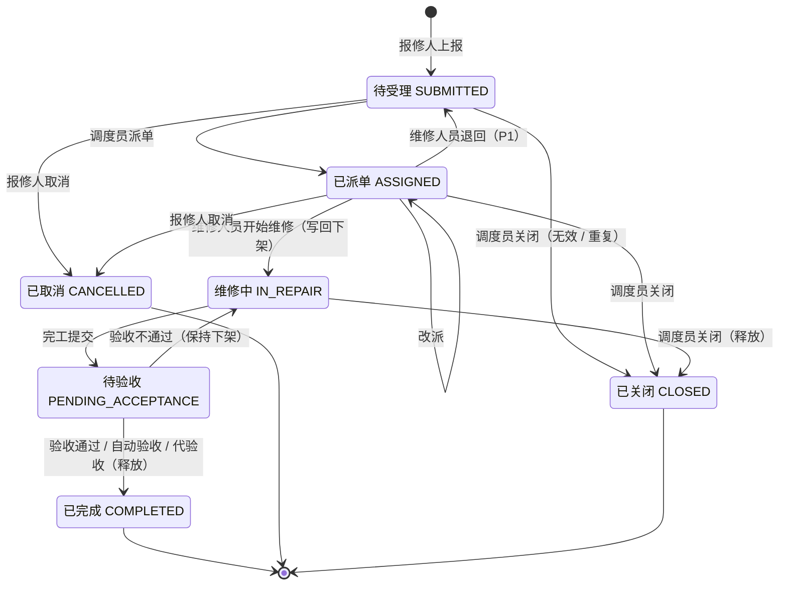

# 需求规格说明 · M3 物业报修工单

> 本文只含 M3 模块自身的需求。来源与优先级标记、编号规则、角色总表、跨模块集成总表、非功能需求与决策记录见[需求总览](README.md)；M3 依赖的身份与权限、空间主数据、通知、审计见[公共层 D](d-platform.md)；M3 写回 M1 所用接口的语义见 [M1 需求](m1-seat-reservation.md) §5.9。

---

## 0. 任务书条目 → 需求映射

| 任务书条目 | 需求编号 |
| --- | --- |
| 故障上报 | M3-RPT-01 ~ 05 |
| 派单 | M3-DSP-01 ~ 05 |
| 维修中状态 | M3-WRK-01 ~ 04 |
| 超时升级 | M3-ESC-01 ~ 04 |
| 完工验收与评价 | M3-ACC-01 ~ 04 |
| M3 → M1：维修中下架全部座位，验收通过后恢复 | M3-INT-01 ~ 03 |
| 附加项：上报故障、查询工单状态、取消工单 | M3-INT-05、M3-RPT-01、M3-RPT-04、M3-QRY-01 |
| 补充集成点：工单事件、一键报修入口 | M3-INT-04、M3-RPT-05 |

---

## 1. 术语

| 术语 | 定义 |
| --- | --- |
| 工单 | 一次报修从上报到关闭的完整记录 |
| 报修人 | 上报故障的用户（学生或教职工），也是默认的验收人 |
| 故障位置 | 楼宇（必选）→ 房间（可选，含公共区域）→ 座位（可选） |
| 故障类别 | 照明、电力与插座、空调与通风、桌椅、门窗与锁、网络、卫生、其他；字典可扩展 |
| 紧急程度 | 一般 / 紧急 |
| 处理阶段 | 受理（提交 → 派单）、响应（派单 → 开始维修）、修复（开始维修 → 完工） |
| 处理时限（SLA） | 每个处理阶段允许的最长时间，按紧急程度区分（BR-M3-04） |
| 升级级别 | L0 未升级；L1 已通知物业调度员；L2 已通知物业主管 |
| 影响范围 | 维修期间受影响的范围：整间（默认）或指定座位（BR-M3-06） |
| 自动验收 | 待验收超过时限、报修人未处理时由系统视为验收通过 |

---

## 2. 角色

| 角色 | 说明 |
| --- | --- |
| 报修人 | 任何拥有 `m3:workorder:create` 的用户（预置授予学生、教职工） |
| 物业调度员 | 受理与派单、改派、关闭无效工单、代验收；数据范围为楼宇 |
| 维修人员 | 处理派给自己的工单：开始维修、记录进度、完工提交、退回；数据范围为楼宇 |
| 物业主管 | 升级工单的最终接收人；查看全部工单、改派、统计 |
| 系统管理员 | 维护故障类别、处理时限；处理写回失败 |
| 系统任务 | 超时升级、自动验收 |
| M1（服务） | 提供占用块写入 / 释放接口 |

权限点见附录 A，全部预置角色见需求总览 §3。

---

## 3. 业务规则与可调参数

| 编号 | 规则 | 来源 | 参数（默认值） |
| --- | --- | --- | --- |
| BR-M3-01 | 工单必须定位到楼宇；房间可选；若选座位，座位须属于所选房间 | `细化` | — |
| BR-M3-02 | 故障类别取自字典，系统管理员可扩展 | `细化` | — |
| BR-M3-03 | 紧急程度由报修人选择，调度员可调整 | `细化` | — |
| BR-M3-04 | 各处理阶段的时限：受理 一般 4 小时 / 紧急 30 分钟；响应 一般 24 小时 / 紧急 2 小时；修复 一般 72 小时 / 紧急 24 小时。进入阶段时计算截止时刻 | `决策` | `m3.sla.accept.*`、`m3.sla.respond.*`、`m3.sla.repair.*` |
| BR-M3-05 | 超时升级：当前阶段超过时限 → 升级到 L1，通知调度员并提醒当前处理人；超过 2 倍时限 → 升级到 L2，通知物业主管。升级不改变处理人；进入下一阶段时升级级别清零 | `原文` / `决策` | — |
| BR-M3-06 | 工单进入「维修中」时写回 M1 下架，影响范围默认整间（满足原文）；可改为指定座位 | `原文` / `决策` | — |
| BR-M3-07 | 下架保持到验收通过（含自动验收、代验收）；工单在「维修中」被关闭时同样释放；验收不通过回到维修中时保持下架 | `原文` / `细化` | — |
| BR-M3-08 | 只有定位到房间的工单才写回；无论房间是否开放为自习室都写回，由 M1 判断影响哪些座位 | `决策` | — |
| BR-M3-09 | 报修人可在「待受理」「已派单」时取消；进入维修中后只能由调度员关闭 | `细化` | — |
| BR-M3-10 | 验收不通过须填写原因，工单回到「维修中」，原维修人员继续处理，修复时限重新计算 | `细化` | — |
| BR-M3-11 | 待验收超过 T 小时报修人未处理，系统自动验收通过（评价留空） | `决策` | `m3.auto_accept_hours`（24） |
| BR-M3-12 | 评价在验收通过时提交，1 至 5 星，文字可选；每张工单只能评价一次 | `细化` | — |
| BR-M3-13 | 同一房间、同一类别已有未关闭工单时，上报前提示可能重复 | `拓展` | — |
| BR-M3-14 | 图片附件每张工单至多 3 张，每张 ≤ 5 MB，仅 jpg / png | `拓展` | `m3.attachment.max_count`（3）、`m3.attachment.max_mb`（5） |
| BR-M3-15 | 维修人员只能处理派给自己的工单；只能派给数据范围覆盖该楼宇的维修人员 | `细化` | — |
| BR-M3-16 | 处理时限参数只影响此后进入新阶段的工单 | `决策` | — |

**时限与升级示例**（默认参数，一般工单）：

| 时刻 | 系统行为 |
| --- | --- |
| 09:00 | 上报，进入受理阶段，受理截止 13:00 |
| 13:00 仍未派单 | 升级 L1：通知调度员，工单在列表置顶并标记「已升级」 |
| 17:00 仍未派单 | 升级 L2：通知物业主管 |
| 17:30 派单 | 进入响应阶段，升级级别清零，响应截止次日 17:30 |

---

## 4. 核心模型

### 4.1 工单状态机

| 转换 | 触发者 | 副作用 |
| --- | --- | --- |
| 上报 → 待受理 | 报修人 | 计算受理截止；通知调度员 |
| 待受理 → 已派单 | 调度员 | 计算响应截止；通知维修人员与报修人 |
| 已派单 → 维修中 | 维修人员 | 写回 `M3_REPAIR` 占用块（`ACTIVE`，无结束时间）；计算修复截止；通知报修人 |
| 维修中 → 待验收 | 维修人员 | 处理说明必填；通知报修人验收；下架保持 |
| 待验收 → 维修中 | 报修人 | 原因必填；修复截止重新计算；通知维修人员 |
| 待验收 → 已完成 | 报修人 / 系统任务 / 调度员 | 释放占用块；记录评价；通知维修人员 |
| 维修中 → 已关闭 | 调度员 | 原因必填；释放占用块；通知报修人 |

---

## 5. 功能需求

### 5.1 上报（M3-RPT）——任务书「故障上报」

#### M3-RPT-01 故障上报
`P0` `原文` · 验证：单元 + 集成 + E2E

报修人选择位置（校区 → 楼宇 → 房间 → 座位级联，数据来自空间主数据）、故障类别、紧急程度，填写描述（必填，10 ~ 500 字）与联系电话（可选）。提交后状态为「待受理」，生成工单号，通知报修人与数据范围覆盖该楼宇的调度员。提交接口支持幂等键。

- 验收标准
  1. 给定合法上报，则状态为「待受理」，详情中可见受理截止时刻，范围内调度员收到通知。
  2. 给定所选座位不属于所选房间，则被拒绝。
  3. 给定描述为空，则被拒绝，错误中标明缺失字段 `description`。
  4. 给定同一幂等键重复提交，则只产生一张工单。

#### M3-RPT-02 图片附件
`P1` `拓展` · 验证：集成

上报与完工时可附图片（BR-M3-14），报修人、调度员、维修人员、物业主管可查看。

- 验收标准
  1. 给定上传第 4 张或单张 6 MB 的图片，则被拒绝并提示限制。

#### M3-RPT-03 重复提示
`P1` `拓展` · 验证：集成

按 BR-M3-13，上报前列出同一房间、同一类别的未关闭工单，报修人可选择继续上报或放弃。

#### M3-RPT-04 取消工单
`P0` `细化`（附加项「取消工单」） · 验证：集成

报修人按 BR-M3-09 取消本人工单，状态置为「已取消」，通知已指派的维修人员。

- 验收标准
  1. 给定工单已派单，则可取消，维修人员收到通知。
  2. 给定工单已在维修中，则取消被拒绝并提示联系调度员。

#### M3-RPT-05 预填位置入口
`P2` `拓展` · 验证：E2E

接受来自 M1 预约详情页的跳转（M1-INT-08），预填楼宇、房间、座位。

### 5.2 派单（M3-DSP）——任务书「派单」

#### M3-DSP-01 受理与派单
`P0` `原文` · 验证：集成 + E2E

调度员在待受理列表中选择工单，指定维修人员（列出数据范围覆盖该楼宇的维修人员及其在办工单数，人员来自 IAM-USER-02），可调整类别与紧急程度。派单后状态为「已派单」，通知维修人员与报修人。

- 验收标准
  1. 给定维修人员的范围不覆盖该楼宇，则不出现在候选列表中；直接调用接口派给他返回 403。
  2. 给定派单成功，则该维修人员的待办中出现该工单，响应截止已计算。

#### M3-DSP-02 改派
`P0` `细化` · 验证：集成

调度员或物业主管可改派「已派单」「维修中」的工单（原因必填）。改派不影响下架状态与当前阶段截止时刻。

#### M3-DSP-03 维修人员退回
`P1` `拓展` · 验证：集成

维修人员可退回「已派单」的工单（原因必填），工单回到「待受理」，通知调度员，受理截止重新计算。

#### M3-DSP-04 自动派单
`P2` `拓展` · 验证：集成

按类别与楼宇规则，自动派给范围内在办工单最少的维修人员。

#### M3-DSP-05 关闭无效工单
`P0` `细化` · 验证：集成

调度员可关闭重复、无效或无需维修的工单（原因必填），通知报修人；若工单在维修中，同时释放下架。

- 验收标准
  1. 给定维修中的工单被关闭，则 10 秒内 M1 中该房间恢复可约（无其他生效块时）。

### 5.3 维修过程（M3-WRK）——任务书「维修中状态」

#### M3-WRK-01 开始维修
`P0` `原文` · 验证：集成 + E2E

维修人员确认到场开始维修，工单进入「维修中」；若工单定位到房间，写回下架（M3-INT-01）；通知报修人。

- 验收标准
  1. 给定工单定位到某自习室，则开始维修后 10 秒内该室全部座位在 M1 中不可约，原因为「维修下架」，追溯中可见工单号。
  2. 给定工单只定位到楼宇，则不写回 M1。

#### M3-WRK-02 维修影响范围
`P1` `拓展` · 验证：集成

开始维修时或维修中，维修人员或调度员可把影响范围从默认「整间」改为「指定座位」（须属于该房间），或改回整间；改动即时同步到 M1 占用块。

- 验收标准
  1. 给定影响范围从整间改为座位 A12，则 10 秒内该室其他座位恢复可约，A12 仍不可约。

#### M3-WRK-03 进度备注
`P1` `拓展` · 验证：E2E

维修人员可追加进度备注（如「等待配件」），报修人可见。

#### M3-WRK-04 完工提交
`P0` `原文` · 验证：集成 + E2E

维修人员填写处理说明（必填），可附完工图片（P1），工单进入「待验收」，通知报修人。下架保持到验收通过。

### 5.4 超时升级（M3-ESC）——任务书「超时升级」

#### M3-ESC-01 时限计算与展示
`P0` `细化` · 验证：单元

进入每个处理阶段时按 BR-M3-04 计算截止时刻；工单详情与工作台显示当前阶段、截止时刻与剩余时间。

#### M3-ESC-02 超时升级
`P0` `原文` · 验证：单元 + 集成

系统任务每分钟扫描，按 BR-M3-05 升级：记录升级级别、阶段与时间，发送通知，工单在工作台置顶并标记。多实例或重启下效果恰好一次。

- 验收标准
  1. 给定一般工单 09:00 上报，则 13:01 前升级到 L1、调度员收到通知；17:01 前升级到 L2、物业主管收到通知。
  2. 给定 12:50 已派单，则受理阶段不再升级，响应阶段重新计时，升级级别清零。
  3. 给定扫描期间服务重启，则同一级别只升级一次、只发一次通知。

#### M3-ESC-03 升级处理
`P1` `细化` · 验证：集成

物业主管可在升级工单上改派、调整紧急程度、添加处理意见。

#### M3-ESC-04 时限配置
`P1` `拓展` · 验证：集成

系统管理员可修改处理时限参数，按 BR-M3-16 生效，写入审计。

### 5.5 验收与评价（M3-ACC）——任务书「完工验收与评价」

#### M3-ACC-01 验收
`P0` `原文` · 验证：集成 + E2E

报修人在「待验收」时选择通过或不通过。通过：工单置为「已完成」，释放下架（M3-INT-02），通知维修人员。不通过（原因必填）：按 BR-M3-10 回到「维修中」，通知维修人员。

- 验收标准
  1. 给定验收通过，且该房间没有其他生效的占用块，则 10 秒内 M1 中该房间恢复可约。
  2. 给定验收不通过，则该房间保持下架，修复截止重新计算。

#### M3-ACC-02 评价
`P0` `原文` · 验证：集成

验收通过时可打 1 ~ 5 星并填写评价（BR-M3-12），维修人员与物业主管可见。

- 验收标准
  1. 给定已评价的工单，当再次提交评价时，则被拒绝。

#### M3-ACC-03 自动验收
`P1` `决策` · 验证：单元 + 集成

按 BR-M3-11，待验收超时由系统自动验收通过，释放下架，通知报修人「已自动验收」。

- 验收标准
  1. 给定待验收 24 小时无人处理，则 1 分钟内工单变为「已完成」，评价为空，M1 恢复可约。

#### M3-ACC-04 代验收
`P1` `拓展` · 验证：集成

报修人无法验收时，调度员可代为验收（原因必填，写入审计），效果同验收通过。

### 5.6 查询与统计（M3-QRY）

#### M3-QRY-01 我的报修
`P0` `细化`（附加项「查询工单状态」） · 验证：E2E

报修人查看本人工单列表与详情时间线：状态变化、派单与改派、升级、进度备注、处理说明、写回状态。

#### M3-QRY-02 工单工作台
`P0` `细化` · 验证：集成 + E2E

调度员看范围内待受理与全部工单；维修人员看「我的待办」；物业主管看全部与已升级工单。可按状态、类别、楼宇、紧急程度、是否升级筛选。

#### M3-QRY-03 统计
`P1` `拓展` · 验证：单元 + 集成

按楼宇、类别、维修人员统计：工单量、平均受理 / 响应 / 修复时长、时限达成率、平均评分。口径以固定种子数据集的手算期望值固化为测试。

#### M3-QRY-04 按位置查历史
`P1` `细化` · 验证：集成

按房间查看历史工单，供 M1 状态追溯（M1-INT-06）中的工单号跳转到工单详情。

### 5.7 跨模块集成（M3-INT）

#### M3-INT-01 下架写回
`P0` `原文` · 验证：集成 + 契约

工单进入「维修中」（含验收不通过后重新进入）时，通过「本地事务 + Outbox」调用 M1 占用块接口（M1-INT-01）：写入来源 `M3_REPAIR`，来源单号为工单号，作用范围为影响范围，区间起点为当前时刻、无结束时间，类型 `ACTIVE`。

- 验收标准
  1. 给定 M1 停止运行期间开始维修，则 M3 状态照常变为「维修中」，写回状态为「同步中」；M1 恢复后自动完成下架。
  2. 给定同一写回消息被投递两次，则 M1 中只有一个占用块。

#### M3-INT-02 恢复写回
`P0` `原文` · 验证：集成 + 契约

工单以任何方式验收通过（验收、自动验收、代验收），或在维修中被关闭时，调用 M1 释放接口（M1-INT-02）。

- 验收标准
  1. 给定同一自习室有两张维修中的工单，当其中一张验收通过时，则该室仍不可约；两张都验收通过后恢复可约。

#### M3-INT-03 写回状态与重试
`P1` `细化` · 验证：集成

工单详情与工作台显示写回状态。超过最大重试次数仍失败时，通知系统管理员，管理员可手动重试。

#### M3-INT-04 工单事件发布
`P1` `拓展` · 验证：契约

工单进入维修中、完成、关闭时发布 `m3.workorder.*` 事件（含工单号、楼宇、房间、影响范围），供 M2（M2-INT-04）等订阅。

#### M3-INT-05 面向代理的公开接口
`P1` `细化`（附加项前提） · 验证：契约

上报故障、查询工单状态与时间线、取消工单，都通过有 OpenAPI 描述的公开接口提供。错误结构化：缺少位置或描述时返回缺失字段名，状态不允许时返回当前状态，便于代理追问而不是擅自执行。

#### M3-INT-06 主数据变更处理
`P2` `细化` · 验证：集成

订阅空间主数据事件（SPC-EVT-01）。房间注销时，该房间未关闭的工单在工作台中标记并通知调度员处理。

---

## 6. 需求追踪矩阵

> 「实现」列填写合并请求或代码位置，「状态」取值：未开始 / 进行中 / 已完成 / 已验证 / 延期（须注明原因）。需求不得从本表删除。

| 需求 | 优先级 | 归属 | 计划验证 | 实现 | 状态 |
| --- | --- | --- | --- | --- | --- |
| M3-RPT-01 | P0 | M3 | 单元、集成、E2E | | 未开始 |
| M3-RPT-02 | P1 | M3 | 集成 | | 未开始 |
| M3-RPT-03 | P1 | M3 | 集成 | | 未开始 |
| M3-RPT-04 | P0 | M3 | 集成 | | 未开始 |
| M3-RPT-05 | P2 | M3 | E2E | | 未开始 |
| M3-DSP-01 | P0 | M3 | 集成、E2E | | 未开始 |
| M3-DSP-02 | P0 | M3 | 集成 | | 未开始 |
| M3-DSP-03 | P1 | M3 | 集成 | | 未开始 |
| M3-DSP-04 | P2 | M3 | 集成 | | 未开始 |
| M3-DSP-05 | P0 | M3 | 集成 | | 未开始 |
| M3-WRK-01 | P0 | M3 | 集成、E2E | | 未开始 |
| M3-WRK-02 | P1 | M3 | 集成 | | 未开始 |
| M3-WRK-03 | P1 | M3 | E2E | | 未开始 |
| M3-WRK-04 | P0 | M3 | 集成、E2E | | 未开始 |
| M3-ESC-01 | P0 | M3 | 单元 | | 未开始 |
| M3-ESC-02 | P0 | M3 | 单元、集成 | | 未开始 |
| M3-ESC-03 | P1 | M3 | 集成 | | 未开始 |
| M3-ESC-04 | P1 | M3 | 集成 | | 未开始 |
| M3-ACC-01 | P0 | M3 | 集成、E2E | | 未开始 |
| M3-ACC-02 | P0 | M3 | 集成 | | 未开始 |
| M3-ACC-03 | P1 | M3 | 单元、集成 | | 未开始 |
| M3-ACC-04 | P1 | M3 | 集成 | | 未开始 |
| M3-QRY-01 | P0 | M3 | E2E | | 未开始 |
| M3-QRY-02 | P0 | M3 | 集成、E2E | | 未开始 |
| M3-QRY-03 | P1 | M3 | 单元、集成 | | 未开始 |
| M3-QRY-04 | P1 | M3 | 集成 | | 未开始 |
| M3-INT-01 | P0 | M3 | 集成、契约 | | 未开始 |
| M3-INT-02 | P0 | M3 | 集成、契约 | | 未开始 |
| M3-INT-03 | P1 | M3 | 集成 | | 未开始 |
| M3-INT-04 | P1 | M3 | 契约 | | 未开始 |
| M3-INT-05 | P1 | M3 | 契约 | | 未开始 |
| M3-INT-06 | P2 | M3 | 集成 | | 未开始 |

统计：共 32 条，其中 P0 15 条、P1 14 条、P2 3 条。

---

## 附录 A：M3 权限点与预置角色

| 权限点 | 说明 | 学生 / 教职工 | 物业调度员 | 维修人员 | 物业主管 | 系统管理员 |
| --- | --- | :-: | :-: | :-: | :-: | :-: |
| `m3:workorder:create` | 上报故障 | ✓ | ✓ | ✓ | ✓ | ✓ |
| `m3:workorder:manage-own` | 查看、取消、验收、评价本人工单 | ✓ | ✓ | ✓ | ✓ | ✓ |
| `m3:dispatch:act` | 派单、改派、关闭、代验收 | | ✓ | | ✓ | ✓ |
| `m3:repair:act` | 开始维修、进度备注、完工、退回、调整影响范围 | | | ✓ | | ✓ |
| `m3:workorder:view-all` | 查看范围内全部工单 | | ✓ | | ✓ | ✓ |
| `m3:escalation:handle` | 处理升级工单 | | | | ✓ | ✓ |
| `m3:stats:view` | 统计 | | | | ✓ | ✓ |
| `m3:config:manage` | 维护故障类别、处理时限 | | | | | ✓ |
| `m3:writeback:retry` | 手动重试写回 | | | | | ✓ |

调度员调整影响范围（M3-WRK-02）使用 `m3:dispatch:act`。

---

## 附录 B：变更记录

| 版本 | 日期 | 变更 |
| --- | --- | --- |
| v0.2 | 2026-10-17 | 初稿：任务书 M3 条目的拓展、细化、明确 |
